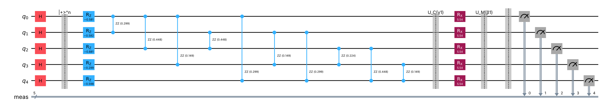
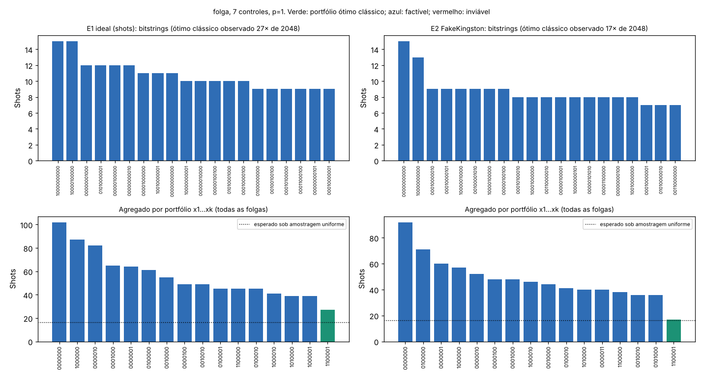
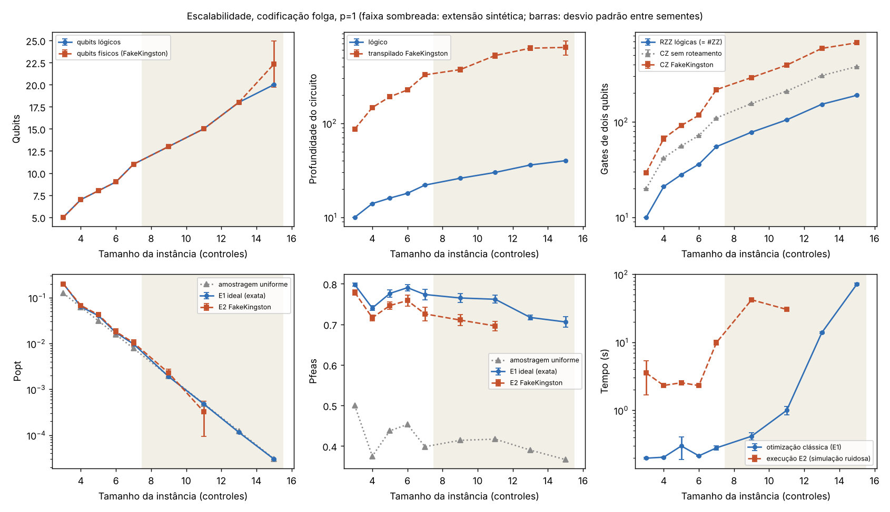
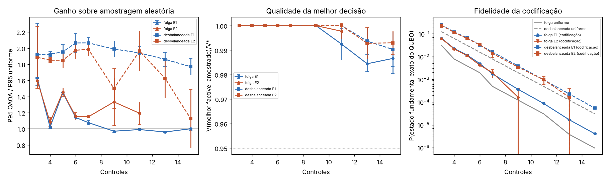

# Relatório técnico — Seleção de controles de cibersegurança sob orçamento com QAOA (ODS 16)

Exercício: *Avaliação Experimental de Problemas de Otimização Alinhados aos Objetivos de Desenvolvimento Sustentável utilizando QAOA* (OQA 2026/2).

Todos os números deste relatório vêm de `exercicio.py` (protocolo completo) e estão em `resultados_exercicio/` (`TABELAS.md`, `execucoes.csv`, `execucoes.json`, `resumo.json`, figuras). As tabelas reproduzidas aqui são cópias de `resultados_exercicio/TABELAS.md`. Os dados são sintéticos e ilustrativos (seção 15).

**Sumário.** 1 Introdução · 2 ODS e justificativa do alinhamento · 3 Descrição do problema · 4 Formulação matemática · 5 Representação binária · 6 Formulação QUBO · 7 Conversão para Ising e Hamiltoniano · 8 Circuito QAOA · 9 Metodologia experimental · 10 Solução clássica de referência · 11 Resultados experimentais · 12 Escalabilidade · 13 Ruído e transpilação · 14 Avaliação no contexto do ODS · 15 Limitações · 16 Conclusão · Apêndice A: respostas Q1–Q22 · Apêndice B: codificação sem folga · Apêndice C: reprodução.

---

## 1. Introdução

Instituições públicas raramente têm orçamento para implantar todos os controles de segurança desejáveis. A decisão de *quais* controles implantar é combinatória: com *k* controles candidatos existem 2^k portfólios, e cada um deve respeitar o orçamento. Este trabalho modela essa decisão como uma mochila 0–1, converte-a em QUBO e em Hamiltoniano de Ising, e executa o QAOA em dois ambientes: simulação ideal (E1) e o *fake backend* FakeKingston, que reproduz topologia, portas nativas e ruído de calibração de um processador IBM Heron r2 de 156 qubits (E2).

A questão central do enunciado é: **até que tamanho de problema o QAOA consegue produzir soluções úteis para uma aplicação associada a um ODS, e quais fatores limitam seu crescimento?** Para respondê-la, o trabalho:

1. define *a priori* um critério de utilidade em dois níveis (seção 9.6), incluindo uma comparação obrigatória com **amostragem uniforme aleatória**, sem a qual não é possível atribuir ao QAOA uma boa solução encontrada entre milhares de medições;
2. executa nove tamanhos de instância (5 a 20 qubits), três sementes por tamanho, p=1,2,3 e dois ambientes;
3. decompõe o efeito do hardware em transpilação, erro de leitura, erro de porta e decoerência;
4. converte o resultado em métricas do domínio (valor de segurança e cobertura de táticas ATT&CK).

Não se pretende demonstrar vantagem quântica, e nenhuma é afirmada.

## 2. Objetivo de Desenvolvimento Sustentável e justificativa do alinhamento

### Justificativa do Alinhamento com os Objetivos de Desenvolvimento Sustentável

#### 2.1 ODS selecionado

- **Número:** ODS 16.
- **Nome:** Paz, Justiça e Instituições Eficazes.
- **Metas relacionadas:** 16.6 (desenvolver instituições eficazes, responsáveis e transparentes em todos os níveis) e 16.10 (assegurar o acesso público à informação e proteger as liberdades fundamentais).
- **Problema tecnológico e institucional associado:** órgãos públicos que oferecem serviços digitais (portal de serviços, base de dados de cidadãos, estações de atendimento) precisam escolher, com orçamento limitado, os controles de segurança que mais reduzem a exposição a ataques. Um incidente compromete a continuidade do serviço público, a confidencialidade dos dados dos cidadãos e a confiança na instituição.

O tema corresponde à linha 13 da Tabela 1 do enunciado (*ODS 16 — Alocação de recursos de cibersegurança: seleção de controles de segurança considerando risco, orçamento e criticidade de serviços*).

> O presente trabalho está alinhado ao ODS 16 – Paz, Justiça e Instituições Eficazes, uma vez que investiga a seleção ótima de controles de cibersegurança para uma instituição pública com orçamento limitado, protegendo serviços digitais e dados de cidadãos que sustentam o funcionamento eficaz e confiável da instituição.

#### 2.2 Problema real associado

- **Recursos alocados:** o orçamento de implantação de controles de segurança (CIS Controls v8), expresso em unidades discretas de custo.
- **Decisões:** implantar ou não cada controle candidato (CIS-1 inventário de hardware, CIS-2 inventário de software, CIS-4 configuração segura, CIS-5 gestão de contas, CIS-7 gestão de vulnerabilidades, CIS-9 proteção de e-mail e navegador, CIS-10 defesa contra malware).
- **Restrições:** a soma dos custos dos controles escolhidos não pode exceder o orçamento *B*. Após a decisão, verifica-se se o portfólio atinge valor mínimo e cobertura mínima de táticas ATT&CK (aceitabilidade organizacional).
- **Resultado a melhorar:** o valor de segurança do portfólio, que combina eficácia ajustada pela adesão humana, cobertura de táticas MITRE ATT&CK, prioridade CIS ponderada pela criticidade e exposição dos ativos, e baixo impacto operacional.

#### 2.3 Indicador otimizado

O indicador otimizado diretamente é o **valor de segurança** V(x) = Σ R_i x_i. Indiretamente, avaliam-se a **cobertura ponderada de táticas ATT&CK** A(x) (fração da relevância das táticas coberta por pelo menos um controle), a **utilização do orçamento** e o **risco residual** representado pelas táticas não cobertas. O valor R_i já incorpora a criticidade e a exposição dos ativos públicos protegidos.

#### 2.4 Relação entre função objetivo e ODS

Maximizar V(x), ou minimizar −V(x), segue a cadeia:

| Decisão matemática | Efeito operacional | Contribuição ao ODS 16 |
|---|---|---|
| x_i = 1 para os controles do portfólio de maior Σ R_i dentro do orçamento | Implantar os controles com maior eficácia efetiva, cobertura de ataques e proteção dos ativos mais críticos e expostos, com menor impacto na operação | Menor probabilidade de interrupção do portal de serviços e de vazamento da base de cidadãos, o que sustenta instituições eficazes (16.6) e protege o acesso à informação e os dados pessoais (16.10) |
| Maximizar o termo de cobertura a_i | Fechar mais táticas ATT&CK (acesso inicial, execução, movimentação lateral, exfiltração) | Redução da superfície de ataque contra serviços públicos |
| Maximizar 1 − f_i | Evitar controles que paralisam o atendimento durante a implantação | Continuidade do serviço público ao cidadão |

#### 2.5 Relação entre restrições e ODS

A restrição Σ c_i x_i ≤ B representa o **limite orçamentário** de uma instituição pública. Ela reflete uma condição real: o orçamento de TI de órgãos públicos é fixado em lei orçamentária e não pode ser excedido; a decisão precisa, portanto, ser a melhor *dentro* do orçamento, e não a mais completa possível. Os limiares pós-decisão V(x) ≥ V_min e A(x) ≥ A_min representam requisitos mínimos de conformidade (por exemplo, uma política interna que exige cobertura mínima de táticas). Eles são avaliados depois da otimização, como no artigo de referência, para não acrescentar variáveis auxiliares.

#### 2.6 Contribuição esperada

Se a solução fosse empregada em um cenário real, a contribuição seria uma **melhor distribuição do orçamento de segurança**: o mesmo orçamento gera mais valor de segurança e mais cobertura de ataques do que uma regra simples, como implantar os controles na ordem numérica do CIS até esgotar o orçamento. A seção 14 quantifica essa diferença. Não é necessário, nem possível com dados sintéticos, demonstrar impacto social real; o que se demonstra é que **a função de otimização representa uma decisão coerente com o ODS 16**.

## 3. Descrição do problema

Uma instituição pública protege três ativos: o portal de serviços públicos, a base de dados de cidadãos e as estações de atendimento. Cada ativo tem impactos de confidencialidade, integridade, disponibilidade, conformidade e reputação, um grau de exposição e dependências com os demais ativos (a base de dados depende do portal, por exemplo). Sete controles CIS são candidatos. Cada um tem custo inteiro (2 a 4 unidades), eficácia técnica, adesão humana, prioridade CIS, impacto operacional, os ativos que protege e as táticas ATT&CK que mitiga. O orçamento de cada instância é ⌊0,45 × custo total dos candidatos⌋. Assim, aproximadamente metade dos controles cabe no orçamento e a escolha não é trivial.

Para estudar o crescimento além dos sete controles reais, a base foi estendida com controles sintéticos S8–S15, aninhados (a instância de 9 controles contém a de 7) e sorteados com semente fixa (2026) **nas mesmas faixas de atributos da base** (custo 2–4, eficácia 0,65–0,90, adesão 0,70–0,90, prioridade 0,80–0,95, impacto 0,15–0,40, 2–3 táticas e 1–3 ativos). A lista completa está em `resultados_exercicio/controles_familia.json`.

## 4. Formulação matemática

**Conjuntos.** C: controles candidatos (|C| = k); A: ativos (3); K: táticas ATT&CK (9).

**Parâmetros.** c_i ∈ ℤ⁺: custo do controle i; B ∈ ℤ⁺: orçamento; e_i: eficácia; ad_i: adesão humana; p_i: prioridade CIS; f_i: impacto operacional; z_ia ∈ {0,1}: o controle i protege o ativo a; m_ik ∈ {0,1}: o controle i mitiga a tática k; q_k: relevância da tática; v_a: criticidade do ativo (impactos ponderados e propagados pelas dependências com η = 0,4); r_a: exposição; λ = 0,5; pesos (α, β, γ, δ) = (0,25; 0,25; 0,25; 0,25).

O valor de cada controle é

R_i = α·(e_i·ad_i) + β·a_i + γ·w_i + δ·(1 − f_i),
a_i = Σ_k q_k m_ik / Σ_k q_k,  w_i = λ·p_i + (1 − λ)·Σ_a z_ia v_a r_a / Σ_a z_ia.

Para a base real: R = (0,6063; 0,5937; 0,5701; 0,5731; 0,6022; 0,5610; 0,6557) e custos c = (2, 2, 3, 3, 4, 2, 3).

**Variáveis.** x_i ∈ {0,1}: implantar o controle i.

**Função objetivo e restrição.**

max V(x) = Σ_{i∈C} R_i x_i, sujeito a g(x) = Σ_{i∈C} c_i x_i − B ≤ 0, x ∈ {0,1}^k,

ou, na forma min f(x) do enunciado, min f(x) = −Σ R_i x_i com g(x) ≤ 0. Não há restrições de igualdade h_j(x) no modelo original; a igualdade surge apenas na codificação com folga (seção 5).

**Pós-avaliação (aceitabilidade).** A(x) = Σ_k q_k min{1, Σ_i m_ik x_i} / Σ_k q_k. Um portfólio é *aceitável* se V(x) ≥ V_min = 1,0 e A(x) ≥ A_min = 0,6.

**Interpretação da solução.** O vetor x* indica quais controles implantar. **Uma solução ótima, no contexto do ODS 16, é o conjunto de controles que entrega o maior valor de segurança possível para os serviços públicos com o orçamento disponível**: nenhum outro conjunto que caiba no orçamento protege melhor, segundo o critério multicritério adotado, os ativos que sustentam o atendimento ao cidadão.

## 5. Representação binária

Cada controle é uma variável de decisão binária:

x_i = 1 se o controle i for implantado; 0 caso contrário.

A desigualdade de orçamento é convertida em igualdade com uma variável de folga inteira s ∈ [0, 2^M − 1], codificada em binário:

Σ_i c_i x_i + s = B,  s = Σ_{m=0}^{M−1} 2^m y_m,  y_m ∈ {0,1},  M = ⌈log₂(B + 1)⌉.

y_m são variáveis auxiliares; não têm significado operacional. O total de variáveis é n = n_decisão + n_auxiliar = k + M:

| Controles k | Orçamento B | M = n_auxiliar | n = qubits |
|---:|---:|---:|---:|
| 3 | 3 | 2 | 5 |
| 4 | 4 | 3 | 7 |
| 5 | 6 | 3 | 8 |
| 6 | 7 | 3 | 9 |
| 7 | 8 | 4 | 11 |
| 9 | 11 | 4 | 13 |
| 11 | 13 | 4 | 15 |
| 13 | 16 | 5 | 18 |
| 15 | 19 | 5 | 20 |

Valores de s > B são representáveis, mas nunca zeram a penalidade (Σ c_i x_i ≥ 0); são estados penalizados, não soluções. Cada portfólio factível tem exatamente uma folga canônica s = B − Σ c_i x_i. Por isso, um mesmo portfólio corresponde a 2^M bitstrings diferentes, e só um deles é o estado de energia correta. Essa distinção entre *decisão* (x) e *codificação completa* (x, y) é central nos resultados.

## 6. Formulação QUBO

Q(x, y) = C(x) + ρ·P(x, y), com

C(x) = −Σ_i R_i x_i (custo original: valor de segurança com sinal trocado),
P(x, y) = (Σ_i c_i x_i + Σ_m 2^m y_m − B)² (violação da igualdade com folga),

o que dá a forma min b^T Q b + ρB², com b = (x, y) ∈ {0,1}^n e Q triangular superior:

Q_ii = ρ(a_i² − 2B a_i) − R_i·[i é controle],  Q_ij = 2ρ a_i a_j (i < j),

em que a = (c_1, …, c_k, 2^0, …, 2^{M−1}). Todos os pares (i, j) têm a_i a_j > 0: o QUBO é **denso** (densidade 1,0, com n(n−1)/2 termos quadráticos). Todo o acoplamento vem da penalidade; a função objetivo original é linear.

**Escolha de λ (ρ).** Usa-se ρ = 1 + Σ_i R_i (5,162 na instância de 7 controles). Justificativa: com custos inteiros, qualquer violação vale pelo menos 1 unidade e é penalizada com pelo menos ρ, que excede o maior ganho possível de valor (Σ R_i). Logo, nenhum estado inviável ou com folga incorreta pode ter energia menor que o melhor estado factível com folga canônica. `ANALISE_MELHORIAS.md` mostra que ρ > max R_i já basta para esta mochila. O valor maior foi mantido para preservar a comparabilidade com o estudo original.

**Verificação experimental de que baixa energia ⇔ solução válida.** Para todas as nove instâncias, a enumeração completa dos 2^n estados confirma que o estado fundamental do QUBO decodifica o ótimo do problema original (`fundamental_e_otimo_original = true` em `resultados_exercicio/modelos/folga_k*/caracteristicas.json`). Os 20 estados de menor energia de cada instância estão em `espectro_20_menores.csv`. Para 7 controles, os onze primeiros:

| Posição | Bitstring (y₃…y₀ x₇…x₁) | Decisão x₁…x₇ | Energia | Factível | Valor | Custo | Cobertura |
|---:|---|---|---:|---|---:|---:|---:|
| 1 | 00011000011 | 1100001 | −1,8557 | sim (ótimo) | 1,8557 | 7 | 66,2% |
| 2 | 00001001001 | 1001001 | −1,8351 | sim | 1,8351 | 8 | 79,4% |
| 3 | 00001000101 | 1010001 | −1,8321 | sim | 1,8321 | 8 | 76,5% |
| 4 | 00011100001 | 1000011 | −1,8230 | sim | 1,8230 | 7 | 55,9% |
| 5 | 00001001010 | 0101001 | −1,8225 | sim | 1,8225 | 8 | 67,6% |
| 6 | 00001000110 | 0110001 | −1,8195 | sim | 1,8195 | 8 | 54,4% |
| 7 | 00011100010 | 0100011 | −1,8104 | sim | 1,8104 | 7 | 58,8% |
| 8 | 00000010011 | 1100100 | −1,8022 | sim | 1,8022 | 8 | 45,6% |
| 9 | 00001101000 | 0001011 | −1,7898 | sim | 1,7898 | 8 | 72,1% |
| 10 | 00001100100 | 0010011 | −1,7868 | sim | 1,7868 | 8 | 69,1% |
| 11 | 00010001011 | 1101000 | −1,7731 | sim | 1,7731 | 7 | 69,1% |

Todos os estados de baixa energia são factíveis e têm a folga canônica. O espectro também mostra uma característica do problema que pesa nos resultados: **os dez portfólios seguintes estão a menos de 4,5% do ótimo**. Os R_i variam pouco (0,56–0,66), porque a média com pesos iguais de quatro critérios normalizados comprime as diferenças. O ótimo é, portanto, pouco destacado.

## 7. Conversão para Ising e construção do Hamiltoniano

Com b_i = (1 − z_i)/2, z_i ∈ {−1, +1}:

H_C = Σ_i h_i Z_i + Σ_{i<j} J_ij Z_i Z_j + C,
J_ij = Q_ij / 4,  h_i = −Q_ii / 2 − Σ_{j≠i} Q_{min(i,j),max(i,j)} / 4,  C = ρB² + Σ_i Q_ii / 2 + Σ_{i<j} Q_ij / 4.

**Coeficientes da instância de 3 controles (5 qubits, B = 3, ρ = 2,770):**

| Qubit | Variável | h_i |
|---:|---|---:|
| 0 | x₁ CIS-1 | −10,7772 |
| 1 | x₂ CIS-2 | −10,7835 |
| 2 | x₃ CIS-4 | −16,3355 |
| 3 | y₀ (2⁰) | −5,5402 |
| 4 | y₁ (2¹) | −11,0803 |

| J_ij | 1 | 2 | 3 | 4 |
|---|---:|---:|---:|---:|
| 0 | 5,5402 | 8,3103 | 2,7701 | 5,5402 |
| 1 | | 8,3103 | 2,7701 | 5,5402 |
| 2 | | | 4,1551 | 8,3103 |
| 3 | | | | 2,7701 |

Termo constante C = 25,4308. A instância de 3 controles tem 5 termos lineares e 10 interações ZZ.

**Instância de 7 controles (11 qubits, B = 8, ρ = 5,162):** h = (−92,61; −92,62; −139,09; −139,09; −185,53; −92,64; −139,05; −46,46; −92,92; −185,84; −371,67), 55 coeficientes J_ij em `resultados_exercicio/modelos/folga_k7/ising_J.csv` e C = 596,72. A instância tem 11 termos lineares e 55 interações ZZ. As contagens de todas as instâncias estão na Tabela 11.1. Em geral, há n termos lineares e n(n−1)/2 interações ZZ.

**Verificação.** Para todos os 2^n estados de todas as instâncias, |E_Ising − E_QUBO| ≤ 10⁻⁸ (campo `erro_max_ising_vs_qubo`). Assim, o estado de menor energia do Hamiltoniano é exatamente a solução ótima do QUBO. O teste `test_folga_qubo_ising_equivalentes` repete essa verificação.

## 8. Construção do circuito QAOA

O estado inicial é |+⟩^{⊗n} (uma porta H por qubit). Para profundidade p,

|γ, β⟩ = Π_{ℓ=1}^{p} e^{−iβ_ℓ H_M} e^{−iγ_ℓ H_C/s} |+⟩^{⊗n},  H_M = Σ_i X_i,

em que s = max_b |E(b)| é uma escala fixa registrada em cada execução (`escala_hamiltoniano`). A escala não altera o estado fundamental; apenas define a unidade de γ. Cada camada é composta por:

- **operador de custo** e^{−iγ H_C/s}: RZ(2γ h_i/s) em cada qubit (termos lineares) e RZZ(2γ J_ij/s) em cada par (interações ZZ). O termo constante C vira fase global;
- **mixer** e^{−iβ H_M}: RX(2β) em cada qubit;
- **medições** na base computacional ao final.

Figura 8.1 — circuito lógico, 3 controles, p = 1 (barreiras rotuladas: estado inicial, U_C(γ₁), U_M(β₁)):



Figura 8.2 — o mesmo circuito transpilado para o FakeKingston (qubits físicos 138, 149–152; portas nativas RZ, √X e CZ):


Os circuitos de 7 controles estão em `resultados_exercicio/circuito_logico_folga_k7.png` e `circuito_transpilado_folga_k7.png`, com versões em texto (`.txt`). Cada execução também guarda o circuito ISA em OpenQASM 3 (`circuito_fake_kingston.qasm`). O teste `test_circuito_didatico_equivale` confirma que a figura com barreiras implementa o mesmo operador do circuito executado, e `test_statevector_equivale_qiskit` confirma que o simulador NumPy usado na otimização coincide com o statevector do Qiskit.

**Relação entre Z_iZ_j e o circuito (Q9).** Cada termo J_ij Z_i Z_j produz exatamente uma porta RZZ(2γJ_ij/s) entre os qubits i e j, porque e^{−iθ Z_i Z_j/2} = RZZ(θ). O número de portas de dois qubits lógicas por camada é, portanto, o número de interações ZZ: 55 para 7 controles. No Heron, a RZZ não é nativa: cada uma vira 2 CZ mais rotações de um qubit. Como o grafo de acoplamento do QUBO é completo e o do hardware é esparso (*heavy-hex*), o roteamento ainda insere SWAPs de 3 CZ cada (seção 13).

## 9. Metodologia experimental

### 9.1 Instâncias

Nove tamanhos: k = 3, 4, 5, 6, 7 (prefixos da base CIS real) e k = 9, 11, 13, 15 (base + controles sintéticos aninhados). O enunciado pede pelo menos cinco tamanhos, e os cinco primeiros cobrem isso com dados da base. A extensão existe para localizar o limite (seção 15). Na codificação com folga, isso dá 5, 7, 8, 9, 11, 13, 15, 18 e 20 qubits. A simulação exaustiva foi limitada a 20 qubits por segurança de memória e tempo.

### 9.2 Ambientes

- **E1 — simulação ideal:** statevector em NumPy, validado contra o `Statevector` do Qiskit. Fornece probabilidades exatas e 2048 shots amostrados dessas probabilidades.
- **E2 — FakeKingston:** `qiskit_ibm_runtime.fake_provider.FakeKingston` (IBM Heron r2, 156 qubits, portas nativas `cz`, `rz`, `sx`, `x`). O circuito lógico com medições é transpilado com `generate_preset_pass_manager(optimization_level=2, backend=FakeKingston)` e executado em `AerSimulator.from_backend(FakeKingston)`, com erros de porta, erros de leitura e relaxação térmica (T1/T2) da calibração do backend, em 2048 shots. E2 foi executado até 17 qubits; acima disso, a simulação ruidosa por trajetórias ficaria inviável (seção 15).
- **E3 — hardware real:** não executado. É opcional no enunciado e exige conta IBM Quantum. O artigo de Santos, Xexéo e Pinto, citado na seção 16, executou uma instância derivada da mesma formulação no `ibm_kingston` real, em outra instância de dados.

Os parâmetros (γ, β) são otimizados apenas em E1 e transferidos sem alteração para E2. Isso isola o efeito do ambiente de execução; não houve reotimização sob ruído.

### 9.3 Otimização dos parâmetros

- Otimizador: COBYLA (SciPy), `rhobeg = 1`, `tol = 1e-5`, até 150·p avaliações por início.
- Função minimizada: E(γ, β) = ⟨γ, β|H_C|γ, β⟩, calculada exatamente pelo statevector e normalizada por s.
- Inícios: dois por execução. Em p = 1, ambos aleatórios (γ ~ U[0, 2π], β ~ U[0, π]). Em p = 2 e 3, um início usa a interpolação INTERP dos parâmetros ótimos de p − 1 (Zhou et al., 2020) e o outro é aleatório. Escolhe-se o de menor energia final.
- Sementes: 42, 43, 44 (otimização, amostragem, transpilação e simulador).
- Registrados por execução: parâmetros iniciais e finais de cada início, avaliações, energia inicial e final, convergência e mensagem do COBYLA, tempo de otimização, curva Energia × Avaliação (`energia_iteracao.png`).

Para o COBYLA, cada iteração corresponde a uma avaliação da função; `optimizer_iterations` registra o total de avaliações de todos os inícios.

### 9.4 Métricas

Para cada execução e ambiente:

- **Popt**: probabilidade de medir o **portfólio ótimo** (qualquer folga). Mede a *fidelidade de decisão*.
- **Pqubo**: probabilidade de medir o **estado fundamental exato do QUBO** (portfólio ótimo e folga canônica). Mede a *fidelidade de codificação*; é a definição de Popt usada no artigo do `ibm_kingston`.
- **Pfeas**: probabilidade de medir um portfólio que respeita o orçamento.
- **P95**: probabilidade de um portfólio factível com V ≥ 0,95·V*.
- **Paceitável**: factível, com V ≥ V_min e A ≥ A_min.
- **E\***: energia ótima (clássica); **E_QAOA**: energia do melhor bitstring amostrado; ⟨H_C⟩: energia esperada.
- **R_app** = V(melhor portfólio factível amostrado) / V\*.
- Melhor bitstring, sua energia, solução decodificada, valor e cobertura; estado mais frequente; indicação se o estado de menor energia foi o mais frequente.
- Recursos: qubits, profundidade, portas totais e de dois qubits do circuito lógico, do circuito na base nativa sem roteamento e do circuito ISA do FakeKingston; número de interações ZZ; shots; tempos de otimização, transpilação e execução.

Em E1, as probabilidades são exatas. Em E2, são frequências de 2048 shots.

### 9.5 Referência de amostragem uniforme

Com 2048 shots e 2^11 = 2048 estados, até um sorteio aleatório observa o ótimo com probabilidade alta. Por isso, cada métrica é comparada com a da **distribuição uniforme sobre os 2^n bitstrings**, que corresponde ao circuito com γ = β = 0 (apenas |+⟩^{⊗n}). O **ganho** é a razão entre a métrica do QAOA e a uniforme (ex.: P95_QAOA / P95_unif).

### 9.6 Critério de utilidade (definido antes da execução)

- **Nível A — decisão útil obtida:** o melhor portfólio factível entre os shots atinge pelo menos 95% do valor ótimo (R_app ≥ 0,95).
- **Nível B — útil e atribuível ao QAOA:** nível A **e** P95 do QAOA maior que P95 da amostragem uniforme. Em E1, usa-se a probabilidade exata. Em E2, usa-se o limite inferior do intervalo de Wilson de 95%, de modo que o ganho não seja atribuído a flutuação de shots.

Uma instância é útil em um nível se a maioria das três sementes satisfaz o critério. A **maior instância útil** é o maior k que satisfaz o critério.

### 9.7 Estudos complementares (7 controles, p = 1, semente 42)

- **Decomposição do ruído:** o mesmo circuito ISA é executado sem ruído, só com erro de leitura, só com decoerência T1/T2, só com erro despolarizante de porta e com o modelo completo.
- **Transpilação:** níveis de otimização 0–3, com e sem roteamento para a topologia física.

### 9.8 Codificação alternativa

Para responder se outra codificação reduz os limites encontrados, a mesma bateria foi executada com **penalização desbalanceada** (Montañez-Barrera et al., 2024), que dispensa a folga: E(x) = −V(x) − λ₁h(x) + λ₂h(x)², com h(x) = B − Σ c_i x_i. Os parâmetros (λ₁, λ₂) foram calibrados **apenas nas instâncias de 3, 4 e 5 controles**: entre os pontos de uma grade cujo estado fundamental é o ótimo nas três, escolheu-se o de maior gap relativo. Depois, ficaram fixos para todas as instâncias. O Apêndice B traz os resultados.

### 9.9 Nota sobre o critério B

Na primeira consolidação, o nível B em E1 usava a probabilidade exata sem margem: qualquer P95 maior que o uniforme, mesmo 0,5% maior, contava como útil. Isso produziu resultados sem sentido, como "útil em 15 controles" com ganho de 1,005×, uma diferença que nunca seria observada com 2048 shots. O critério foi então unificado: nos dois ambientes, o ganho precisa ser detectável com os shots usados (limite de Wilson). A correção foi aplicada aos dados já salvos, sem nova execução (`python exercicio.py --reanalisar`), e é registrada aqui por transparência.

## 10. Solução clássica de referência

Cada instância foi resolvida exatamente de dois modos independentes: **programação dinâmica** O(k·B) sobre os custos inteiros (`classico.py`) e **enumeração exaustiva** dos 2^n estados do QUBO, x\* = arg min Q(x). Os dois coincidem em todas as instâncias, e o estado fundamental do QUBO decodifica o mesmo portfólio.

| Controles | B | Decisão ótima x₁…x_k | V\* | Custo | Tempo DP | Tempo enumeração 2^k |
|---:|---:|---|---:|---:|---:|---:|
| 3 | 3 | 100 | 0,6063 | 2 | 72 µs | 0,06 ms |
| 4 | 4 | 1100 | 1,2000 | 4 | 76 µs | 0,03 ms |
| 5 | 6 | 10001 | 1,2085 | 6 | 85 µs | 0,03 ms |
| 6 | 7 | 110100 | 1,7731 | 7 | 91 µs | 0,02 ms |
| 7 | 8 | 1100001 | 1,8557 | 7 | 99 µs | 0,05 ms |
| 9 | 11 | 110001101 | 3,0090 | 11 | 116 µs | 0,12 ms |
| 11 | 13 | 11000110101 | 3,6226 | 13 | 134 µs | 0,21 ms |
| 13 | 16 | 1100011010110 | 4,2626 | 16 | 154 µs | 1,15 ms |
| 15 | 19 | 110001101011010 | 4,8363 | 19 | 171 µs | 4,52 ms |

Na base real de 7 controles, o ótimo é **CIS-1 (inventário de hardware), CIS-2 (inventário de software) e CIS-10 (defesa contra malware)**, com custo 7 de 8, valor 1,8557 e cobertura ATT&CK de 66,2%. O portfólio é aceitável (V ≥ 1,0 e A ≥ 0,6). A programação dinâmica resolve todos os tamanhos em menos de 0,2 ms. A mochila com orçamento inteiro pequeno é pseudopolinomial e classicamente fácil, um fato que pesa na discussão sobre vantagem quântica (Q22).

## 11. Resultados experimentais

### 11.1 Características dos problemas (seção 12.1 do enunciado)

| Controles | Var. decisão | Auxiliares | Qubits | Restrições | Termos lineares | Termos quadráticos (= #ZZ) | Densidade | Portfólios factíveis | max abs(E)/V\* | ρ |
|---:|---:|---:|---:|---:|---:|---:|---:|---:|---:|---:|
| 3 | 3 | 2 | 5 | 1 | 5 | 10 | 1,00 | 4/8 | 221 | 2,770 |
| 4 | 4 | 3 | 7 | 1 | 7 | 21 | 1,00 | 6/16 | 469 | 3,343 |
| 5 | 5 | 3 | 8 | 1 | 8 | 28 | 1,00 | 14/32 | 732 | 3,945 |
| 6 | 6 | 3 | 9 | 1 | 9 | 36 | 1,00 | 29/64 | 649 | 4,506 |
| 7 | 7 | 4 | 11 | 1 | 11 | 55 | 1,00 | 51/128 | 1878 | 5,162 |
| 9 | 9 | 4 | 13 | 1 | 13 | 78 | 1,00 | 212/512 | 1768 | 6,334 |
| 11 | 11 | 4 | 15 | 1 | 15 | 105 | 1,00 | 854/2048 | 1983 | 7,484 |
| 13 | 13 | 5 | 18 | 1 | 18 | 153 | 1,00 | 3194/8192 | 5317 | 8,718 |
| 15 | 15 | 5 | 20 | 1 | 20 | 190 | 1,00 | 12014/32768 | 6175 | 9,876 |

A coluna max abs(E)/V\* mede quanto a penalidade domina a escala do Hamiltoniano. Como γ multiplica H_C/s, a diferença de valor entre o ótimo e o segundo melhor portfólio (0,02) vira uma fase da ordem de 10⁻⁵ rad. Esse é o mecanismo central dos resultados (seção 12.3).

### 11.2 Otimização dos parâmetros (seção 10 do enunciado)

Registro da execução de 7 controles, p = 1, semente 42. Todos os registros estão em `execucoes/*/resultado.json`:

| Início | (γ, β) iniciais | (γ, β) finais | Avaliações | Energia inicial | Energia final | Convergiu | Tempo |
|---|---|---|---:|---:|---:|---|---:|
| 1 (aleatório) | (4,8629; 1,3788) | (6,2396; 2,6474) | 150 | 833,16 | 92,66 | não (limite de avaliações) | 0,15 s |
| 2 (aleatório, escolhido) | (5,3947; 2,1908) | (6,7109; 2,6580) | 150 | 247,25 | 90,91 | não (limite de avaliações) | 0,14 s |

A curva Energia × Avaliação de cada execução está em `energia_iteracao.png`. Em todas as execuções, a energia cai rapidamente nas primeiras dezenas de avaliações e depois oscila em um platô. Só 4 dos 132 inícios terminaram pelo critério de tolerância do COBYLA; os demais esgotaram o orçamento de avaliações. A energia final, porém, varia pouco entre sementes em p = 1 (⟨H_C⟩ = 93,8 ± 2,2 em 7 controles, seção 11.5). O orçamento do otimizador não explica a baixa qualidade, que vem da paisagem de energia (seção 12.3).

### 11.3 Tabela 2 — Comparação entre solução clássica e QAOA (p = 1)

Codificação padrão com folga. Médias ± desvio padrão entre 3 sementes. E1 em probabilidade exata e E2 em frequência de 2048 shots. "QAOA" é a melhor decisão factível entre os shots; entre parênteses, quantas sementes a obtiveram; ✓ marca a decisão ótima.

| Instância | Qubits | Clássico | QAOA E1 | QAOA E2 | E\* | E_QAOA E1 | E_QAOA E2 | Popt E1 | Popt E2 | Pfeas E1 | Pfeas E2 | Popt unif. | Pfeas unif. |
|---:|---:|---|---|---|---:|---:|---:|---:|---:|---:|---:|---:|---:|
| 3 | 5 | 100 | 100 ✓ (3) | 100 ✓ (3) | −0,6063 | −0,6063 | −0,6063 | 0,2037 | 0,1997 | 0,798 | 0,779 | 0,1250 | 0,500 |
| 4 | 7 | 1100 | 1100 ✓ (3) | 1100 ✓ (3) | −1,2000 | −1,2000 | −1,2000 | 0,0637 | 0,0677 | 0,740 | 0,716 | 0,0625 | 0,375 |
| 5 | 8 | 10001 | 10001 ✓ (3) | 10001 ✓ (3) | −1,2085 | −1,2085 | −1,2085 | 0,0404 | 0,0425 | 0,776 | 0,746 | 0,0312 | 0,438 |
| 6 | 9 | 110100 | 110100 ✓ (3) | 110100 ✓ (3) | −1,7731 | −1,7731 | −1,7731 | 0,0172 | 0,0181 | 0,790 | 0,759 | 0,0156 | 0,453 |
| 7 | 11 | 1100001 | 1100001 ✓ (3) | 1100001 ✓ (3) | −1,8557 | −1,8557 | −1,8557 | 0,0097 | 0,0104 | 0,773 | 0,726 | 0,0078 | 0,398 |
| 9 | 13 | 110001101 | ✓ (3) | ✓ (3) | −3,0090 | −2,953 ± 0,040 | −2,797 ± 0,242 | 0,0019 | 0,0023 | 0,765 | 0,710 | 0,0020 | 0,414 |
| 11 | 15 | 11000110101 | ✓ (1); 2 subótimas | ✓ (2); 1 subótima | −3,6226 | −3,595 ± 0,024 | −3,557 ± 0,007 | 0,00048 | 0,00033 | 0,762 | 0,696 | 0,00049 | 0,417 |
| 13 | 18 | 1100011010110 | 3 subótimas | não executado | −4,2626 | −3,981 ± 0,211 | – | 0,00012 | – | 0,717 | – | 0,00012 | 0,390 |
| 15 | 20 | 110001101011010 | 3 subótimas | não executado | −4,8363 | −4,735 ± 0,063 | – | 0,00003 | – | 0,706 | – | 0,00003 | 0,367 |

Desvios de Popt e Pfeas entre sementes: no máximo 0,013 em E1 e 0,017 em E2 (`resultados_exercicio/TABELAS.md`). As decisões subótimas de 11–15 controles ficam a 0,5–2% do ótimo em valor (R_app de 0,98 a 0,995). Em 9 controles, o portfólio ótimo foi amostrado, mas E_QAOA > E\*: o estado fundamental exato, com a folga canônica, não apareceu. A fidelidade de decisão persiste por mais tamanhos que a fidelidade de codificação, como no artigo do `ibm_kingston`.

**Leitura da tabela.** O QAOA encontrou o portfólio ótimo entre os shots em todas as sementes até 9 controles, nos dois ambientes. Mas a coluna Popt mostra que a **probabilidade do ótimo é praticamente a mesma da amostragem uniforme** em todos os tamanhos: 0,0097 contra 0,0078 em 7 controles, e 0,0019 contra 0,0020 em 9. O QAOA aprendeu a **factibilidade** (Pfeas ≈ 0,71–0,80, contra 0,37–0,50 do uniforme), mas não o **valor**. Pela orientação do enunciado, não se afirma vantagem quântica por o QAOA ter encontrado o ótimo: com 2048 shots, um sorteio uniforme também o teria encontrado.

### 11.4 Análise das medições (seção 13 do enunciado)

O histograma de cada execução (`execucoes/*/histograma.png`) tem duas linhas. A primeira mostra os 20 bitstrings mais medidos, coloridos por ótimo (verde), factível (azul) ou inviável (vermelho). A segunda agrega os bitstrings por portfólio (todas as folgas) e traça a frequência esperada sob amostragem uniforme. A Figura 11.1 mostra 7 controles com p = 1:



- **Solução ótima:** CIS-1+CIS-2+CIS-10 (`1100001`), observada 27 vezes em E1 e 17 em E2 de 2048, perto das 16 esperadas sob amostragem uniforme.
- **Soluções subótimas:** os portfólios de 2–3 controles a menos de 5% do ótimo (seção 6) somam P95 = 0,109 (E1) e 0,117 (E2), contra 0,102 do uniforme.
- **Soluções factíveis:** 77% (E1) e 73% (E2) das medições respeitam o orçamento, concentradas em portfólios **vazios ou de um só controle**.
- **Soluções não factíveis:** 23% (E1) e 27% (E2).

**O estado de menor energia foi também o de maior probabilidade?** Não. Em 7 controles, o estado mais frequente foi o portfólio vazio: em E1, `10000000000` (folga 8, energia 0); em E2, `00000000000` (folga 0, penalidade 64ρ). Entre todas as 126 combinações de execução e ambiente, o estado de menor energia amostrado foi o mais frequente em apenas 10, **nenhuma na codificação com folga**; as 10 são da codificação sem folga, em 3–6 controles. A explicação é a paisagem de energia. A penalidade domina ⟨H_C⟩, então o otimizador reduz a energia média deslocando probabilidade para portfólios baratos, que nunca violam o orçamento. O valor de segurança é 10²–10⁴ vezes menor que a escala da penalidade, e as diferenças entre portfólios bons são ainda menores; por isso, quase não influenciam o otimizador. O portfólio vazio é factível, mas inútil para o ODS: valor 0 e cobertura 0.

### 11.5 Influência da profundidade p (seção 17 do enunciado), 7 controles

| p | Ambiente | ⟨H_C⟩ | Popt | Pfeas | P95 | Pqubo | Profundidade | Gates 2q | Tempo de otimização | Avaliações |
|---:|---|---:|---:|---:|---:|---:|---:|---:|---:|---:|
| 1 | E1 | 93,8 ± 2,2 | 0,0097 | 0,773 | 0,109 | 0,0017 | 22 | 55 | 0,28 s | 300 |
| 1 | E2 | 140,6 ± 5,5 | 0,0104 | 0,726 | 0,117 | 0,0020 | 327 | 218 | | |
| 2 | E1 | 63,4 ± 0,9 | 0,0096 | 0,833 | 0,103 | 0,0021 | 35 | 110 | 0,68 s | 600 |
| 2 | E2 | 126,8 ± 14,0 | 0,0085 | 0,760 | 0,113 | 0,0021 | 584 | 429 | | |
| 3 | E1 | 52,9 ± 8,7 | 0,0114 | 0,826 | 0,122 | 0,0026 | 48 | 165 | 1,21 s | 900 |
| 3 | E2 | 110,7 ± 9,8 | 0,0086 | 0,741 | 0,121 | 0,0011 | 864 | 640 | | |

(Profundidade e gates: circuito lógico em E1 e circuito ISA em E2.)

**O aumento de p produziu melhor solução?** Em energia, sim: ⟨H_C⟩ ideal caiu 44% de p = 1 para p = 3, e Pfeas subiu de 0,77 para 0,83. Em qualidade de decisão, não de forma consistente: Popt variou de 0,0097 para 0,0114 (+18%, dentro de 1,5 desvio) e P95 de 0,109 para 0,122. Sob ruído (E2), Popt *caiu* de 0,0104 para 0,0086, e a fidelidade de codificação Pqubo caiu de 0,0020 para 0,0011. **Custo:** gates de dois qubits ×3 (lógicos 55 → 165; ISA 218 → 640), profundidade ISA ×2,6 (327 → 864) e tempo de otimização ×4,3 (0,28 → 1,21 s), com 3× mais avaliações. Na codificação com folga, aumentar p gasta recursos para melhorar sobretudo a factibilidade. A codificação sem folga mostra que a profundidade passa a ajudar quando a paisagem é melhor condicionada: P95 ideal +33% de p = 1 para p = 3 (Apêndice B).

Figura: `resultados_exercicio/profundidade_p_folga.png`.

## 12. Análise de escalabilidade

### 12.1 Gráficos

Os seis gráficos exigidos (qubits, profundidade, gates de dois qubits, Popt, Pfeas e tempo, todos contra o tamanho da instância) estão na Figura 12.1, com E1, E2 e a referência uniforme:



Recursos por tamanho (p = 1, médias de 3 sementes):

| Controles | Qubits | Depth lógico | Depth ISA | Gates lógicos | Gates ISA | #ZZ (2q lógicos) | CZ sem roteamento | CZ ISA | Shots | Tempo otimização | Tempo E2 |
|---:|---:|---:|---:|---:|---:|---:|---:|---:|---:|---:|---:|
| 3 | 5 | 10 | 87 | 25 | 145 | 10 | 20 | 29 | 2048 | 0,20 s | 3,5 s |
| 4 | 7 | 14 | 147 | 42 | 319 | 21 | 42 | 67 | 2048 | 0,20 s | 2,3 s |
| 5 | 8 | 16 | 191 | 52 | 431 | 28 | 56 | 92 | 2048 | 0,30 s | 2,5 s |
| 6 | 9 | 18 | 226 | 63 | 563 | 36 | 72 | 117 | 2048 | 0,21 s | 2,3 s |
| 7 | 11 | 22 | 327 | 88 | 907 | 55 | 110 | 218 | 2048 | 0,28 s | 9,9 s |
| 9 | 13 | 26 | 372 | 117 | 1315 | 78 | 156 | 292 | 2048 | 0,41 s | 42,2 s |
| 11 | 15 | 30 | 525 | 150 | 1716 | 105 | 210 | 393 | 2048 | 1,00 s | 30,5 s |
| 13 | 18 | 36 | 629 | 207 | 2589 | 153 | 306 | 589 | 2048 | 13,9 s | – |
| 15 | 20 | 40 | 641 | 250 | 3071 | 190 | 380 | 675 | 2048 | 71,8 s | – |

### 12.2 Quais recursos crescem mais

Ajustes nos nove tamanhos (n = qubits; expoente de lei de potência e fator por qubit):

| Grandeza | 5 → 20 qubits | Crescimento |
|---|---|---|
| Qubits | 5 → 20 | n = k + ⌈log₂(B+1)⌉, linear em k |
| Interações ZZ / RZZ lógicas | 10 → 190 | n(n−1)/2, ∝ n^2,1 |
| CZ após transpilação | 29 → 675 | ∝ n^2,3 (1,45–2,0 × o número sem roteamento) |
| Profundidade ISA | 87 → 641 | ∝ n^1,5 |
| Gates ISA totais | 145 → 3071 | ∝ n^2,2 |
| Tempo de otimização (simulação clássica) | 0,20 → 71,8 s | exponencial, ×1,46 por qubit |
| Tempo da simulação ruidosa E2 | 3,5 → 30–42 s (até 15 qubits) | ×1,37 por qubit |
| Popt ideal | 0,20 → 3·10⁻⁵ | decai ×0,55 por qubit (≈ 2^−n, como o uniforme) |
| Pqubo ideal | 0,064 → 4·10⁻⁶ | decai ×0,52 por qubit |
| P95 ideal | 0,41 → 0,0027 | decai ×0,71 por qubit |
| Pfeas ideal | 0,80 → 0,71 | quase constante |

**O crescimento mais significativo**, do lado quântico, é o dos **gates de dois qubits**: são quadráticos porque o QUBO com folga é denso, e o roteamento para a topologia do Heron quase os dobra. Do lado da simulação clássica, o mais significativo é o **tempo**, exponencial no número de qubits. Do lado da qualidade, as probabilidades do ótimo decaem exponencialmente, no mesmo ritmo da amostragem uniforme.

### 12.3 Por que a qualidade acompanha o acaso

A Figura 12.2 resume o achado principal. À esquerda, o ganho P95_QAOA / P95_uniforme. Ao centro, a qualidade da melhor decisão amostrada. À direita, a fidelidade da codificação.



Com folga, o ganho fica entre 1,0 e 1,6 até 7 controles e cai para ≈ 1,0 (0,96–1,00) a partir de 9 controles, mesmo na simulação ideal. Há três causas, todas da codificação:

1. **Domínio da penalidade:** max abs(E)/V\* vai de 221 a 6175. Na escala que o otimizador enxerga, o valor de segurança é ruído numérico, e a energia média é minimizada empurrando probabilidade para portfólios baratos (Pfeas alto, P95 ≈ uniforme).
2. **Degenerescência da folga:** cada portfólio corresponde a 2^M bitstrings, e só um tem energia correta. A fidelidade de codificação (Pqubo) fica uma ordem de grandeza abaixo da fidelidade de decisão (Popt).
3. **Valores pouco diferenciados:** R_i ∈ [0,56; 0,66]. Os dez melhores portfólios ficam a menos de 4,5% do ótimo, o que torna P95 alto até para o acaso e o ótimo pouco destacado.

## 13. Análise de ruído e transpilação

### 13.1 Ideal × ruído por tamanho (seção 19 do enunciado)

| Controles | Popt ideal | Popt ruído | Pfeas ideal | Pfeas ruído | P95 ideal | P95 ruído | Δ_ruído Pfeas | CZ ISA |
|---:|---:|---:|---:|---:|---:|---:|---:|---:|
| 3 | 0,2037 | 0,1997 | 0,798 | 0,779 | 0,407 | 0,400 | 0,019 | 29 |
| 4 | 0,0637 | 0,0677 | 0,740 | 0,716 | 0,064 | 0,068 | 0,024 | 67 |
| 5 | 0,0404 | 0,0425 | 0,776 | 0,746 | 0,317 | 0,318 | 0,030 | 92 |
| 6 | 0,0172 | 0,0181 | 0,790 | 0,759 | 0,125 | 0,126 | 0,032 | 117 |
| 7 | 0,0097 | 0,0104 | 0,773 | 0,726 | 0,109 | 0,117 | 0,048 | 218 |
| 9 | 0,0019 | 0,0023 | 0,765 | 0,710 | 0,0057 | 0,0078 | 0,054 | 292 |
| 11 | 0,00048 | 0,00033 | 0,762 | 0,696 | 0,0092 | 0,0111 | 0,066 | 393 |

Com folga, P^ideal_opt ≈ P^noise_opt em todos os tamanhos: diferenças de no máximo 0,004, dentro da flutuação de shots. O efeito mensurável do ruído é sobre a **factibilidade**: P^ideal_feas − P^noise_feas cresce de 1,9 para 6,6 pontos percentuais à medida que as CZ passam de 29 para 393. A interpretação é direta: o ruído destrói a informação que o circuito carrega, e na codificação com folga o circuito só carrega informação sobre factibilidade, que é justamente o que se perde. Na codificação sem folga, em que o circuito carrega informação de valor, o ruído reduz o ganho sobre o acaso de 1,77 (ideal) para 1,13 (FakeKingston) em 15 qubits (Apêndice B).

### 13.2 Decomposição do ruído (7 controles, folga, p = 1, semente 42)

| Variante (mesmo circuito ISA) | Popt | Pfeas | P95 | Pqubo | ⟨H_C⟩ |
|---|---:|---:|---:|---:|---:|
| E1 ideal (exata, circuito lógico) | 0,0095 | 0,791 | 0,106 | 0,0018 | 90,9 |
| ISA sem ruído (2048 shots) | 0,0078 | 0,774 | 0,115 | 0,0015 | 88,9 |
| Só erro de leitura | 0,0088 | 0,766 | 0,116 | 0,0010 | 97,1 |
| Só decoerência (T1/T2) | 0,0093 | 0,783 | 0,107 | 0,0020 | 103,7 |
| Só erro despolarizante de porta | 0,0098 | 0,747 | 0,118 | 0,0024 | 133,6 |
| FakeKingston completo | 0,0083 | 0,745 | 0,115 | 0,0029 | 134,1 |

- **Transpilação:** sem ruído, o circuito ISA reproduz o ideal dentro da flutuação de shots (σ ≈ 0,002 em Popt; 0,007 em P95). A transpilação é exata e, sozinha, não degrada a solução.
- **Erros de porta:** são o fator dominante. Respondem por quase todo o aumento de ⟨H_C⟩ (+44,7 de +45,2) e pela maior perda de factibilidade (−2,8 p.p.). Na calibração do FakeKingston, o erro mediano de CZ é 1,8·10⁻³ e o de √X é 2,4·10⁻⁴. Com 204 CZ, a probabilidade de nenhuma falha de dois qubits é ≈ (1 − 0,0018)^204 ≈ 0,69, e cai exponencialmente com o número de CZ: ≈ 0,49 com as 393 CZ de 11 controles.
- **Erros de leitura:** erro mediano de 0,95% por qubit; +8,2 em ⟨H_C⟩ e −0,9 p.p. em Pfeas.
- **Decoerência:** +14,8 em ⟨H_C⟩ e efeito em Pfeas dentro da flutuação. Medianas da calibração: T1 = 283 µs e T2 = 144 µs, com CZ de 68 ns. As 321 camadas ISA somam alguns µs a ~20 µs, ainda curtos perto de T2. A decoerência cresceria com a profundidade de p maior.
- **Conectividade:** atua por meio das CZ adicionais do roteamento (13.3).

### 13.3 Circuito antes e depois da transpilação (seção 20 do enunciado)

Instância de 7 controles, p = 1, semente 42 (FakeKingston, nível 2, o padrão do protocolo):

| Métrica | Antes (lógico) | Base nativa sem roteamento | Depois (FakeKingston) |
|---|---:|---:|---:|
| Qubits | 11 | 11 | 11 físicos |
| Depth | 22 | 125 | 321 |
| Gates | 88 | 481 | 868 |
| Two-qubit gates | 55 RZZ | 110 CZ | 204 CZ |

Efeito do nível de otimização da transpilação no mesmo circuito:

| Nível | Depth ISA | Gates ISA | CZ ISA | Popt E2 | Pfeas E2 |
|---:|---:|---:|---:|---:|---:|
| 0 | 550 | 1500 | 302 | 0,0137 | 0,711 |
| 1 | 356 | 1157 | 263 | 0,0093 | 0,741 |
| 2 | 321 | 868 | 204 | 0,0083 | 0,745 |
| 3 | 321 | 863 | 204 | 0,0127 | 0,743 |

As variações de Popt entre níveis (0,008–0,014) estão dentro da flutuação de shots (σ ≈ 0,002 por nível, uma única semente). Pfeas melhora do nível 0 para os níveis 1–3, acompanhando a queda de 302 para 204 CZ.

**Por que a adaptação à topologia física aumenta o custo.** Há dois efeitos que se somam. (i) **Base nativa:** a RZZ não existe no Heron. Cada uma vira 2 CZ e rotações de um qubit (RZ, √X), o que dobra as portas de dois qubits (55 → 110) e multiplica a profundidade por ~6 (22 → 125). (ii) **Conectividade:** o QUBO exige interação entre *todos* os pares de qubits (grafo completo, 55 arestas), mas o Heron r2 só acopla vizinhos de uma rede *heavy-hex* (grau 2–3). O roteador insere SWAPs, cada um com 3 CZ: as 94 CZ extras (110 → 204) equivalem a cerca de 31 SWAPs, e a profundidade passa de 125 para 321. Em 15 controles (20 qubits lógicos), o roteamento usou de 20 a 26 qubits físicos, conforme a semente (Figura 12.1, painel de qubits), passando informação por qubits intermediários. Como cada CZ adicional traz erro (13.2), o custo de roteamento se converte diretamente em perda de qualidade.

## 14. Avaliação quantitativa do resultado no contexto do ODS

**Cenário de referência:** a instituição implanta os controles na ordem numérica do CIS (CIS-1, CIS-2, CIS-4, …) até esgotar o orçamento, uma regra simples e comum de priorização. **Cenário otimizado:** o portfólio ótimo, que é também a melhor decisão amostrada pelo QAOA. Métricas do domínio: valor de segurança V e cobertura ponderada de táticas ATT&CK A. Δ = (V_otimizado − V_referência)/V_referência × 100. Para a cobertura, a diferença é dada em pontos percentuais.

**7 controles (base real, B = 8):**

| Cenário | Portfólio | Valor | Δ valor | Cobertura ATT&CK | Δ cobertura | Custo |
|---|---|---:|---:|---:|---:|---:|
| Referência: ordem CIS | CIS-1, CIS-2, CIS-4 | 1,7701 | — | 55,9% | — | 7 |
| Heurística gulosa valor/custo | CIS-1, CIS-2, CIS-9 | 1,7610 | −0,5% | 45,6% | −10,3 p.p. | 6 |
| Portfólio factível aleatório (média) | — | 1,3385 | −24,4% | 47,7% | −8,2 p.p. | 5,8 |
| **Ótimo clássico = melhor amostra do QAOA (E1 e E2, 3/3 sementes)** | **CIS-1, CIS-2, CIS-10** | **1,8557** | **+4,8%** | **66,2%** | **+10,3 p.p.** | **7** |
| QAOA: estado mais frequente (média, E1) | quase vazio | 0,3889 | −78,0% | 15,7% | −40,2 p.p. | 1,7 |
| QAOA: estado mais frequente (média, E2) | quase vazio | 0,1870 | −89,4% | 9,3% | −46,6 p.p. | 0,7 |

**Interpretação operacional.** Pelo mesmo custo (7 unidades), trocar a configuração segura (CIS-4) pela defesa contra malware (CIS-10) aumenta o valor de segurança em 4,8%. A cobertura passa a incluir as táticas **Collection** e **Exfiltration**, e a cobertura ponderada sobe 10,3 p.p. (de 55,9% para 66,2%), com a perda de Defense Evasion. No contexto do ODS 16, isso significa proteger diretamente contra a **exfiltração da base de dados de cidadãos** (meta 16.10: proteção das liberdades fundamentais e dos dados pessoais) sem aumentar o gasto (meta 16.6: uso eficaz dos recursos públicos).

**11 controles (com extensão sintética, B = 13):** referência V = 2,9042 (79,4%). Ótimo V = 3,6226, **+24,7%** e +8,8 p.p. de cobertura (88,2%). Melhor amostra do QAOA em E2: V = 3,6144 (+24,5%, 99,8% do ótimo). Heurística gulosa: +20,6%. Quanto maior a instância, maior o ganho de uma decisão otimizada sobre a regra simples.

**O que é atribuível ao QAOA.** O benefício acima é o da **decisão otimizada**, e o QAOA o entrega quando se avaliam classicamente os 2048 shots e se escolhe o melhor portfólio factível. A *saída típica* do QAOA (estado mais frequente) é muito pior que a referência (−78% a −89% em 7 controles). E a amostragem uniforme, com a mesma avaliação clássica, também teria encontrado um portfólio a menos de 5% do ótimo com probabilidade ≥ 0,996 em todos os tamanhos. Na codificação padrão, portanto, o benefício para o ODS vem do conjunto "amostragem + avaliação clássica", e não de uma concentração de probabilidade produzida pelo circuito.

## 15. Limitações

### 15.1 Limite experimental (seção 23 do enunciado)

| Codificação | Ambiente | Útil e atribuível ao QAOA (nível B) | Degradação significativa | Fator limitante |
|---|---|---|---|---|
| Com folga (padrão) | E1 ideal | 3, 5, 6 controles (até 9 qubits) | a partir de 9 controles (13 qubits): ganho 0,95–1,00 | **Codificação**: domínio da penalidade e degenerescência da folga. O limite aparece sem ruído |
| Com folga (padrão) | E2 FakeKingston | 3, 5, 6, 7 controles (até 11 qubits) | a partir de 9 controles (1/3 sementes) | Codificação; o ruído reduz Pfeas em até 6,6 p.p. |
| Sem folga | E1 ideal | 3–13 controles (até 13 qubits) | 15 controles (1/3 sementes) | Decaimento de P95 com 2^n e escala da penalidade |
| Sem folga | E2 FakeKingston | 3–11 controles (até 11 qubits) | 13 controles (1/3) e 15 (0/3): ganho 1,96 → 1,63 → 1,13 | **Ruído das portas de dois qubits**: CZ 218 → 292 → 393 |
| Ambas | Simulação | E2 até 17 qubits; E1 até 20 | E2 com 17 qubits: ~143 s por 1024 shots; E1 com 20 qubits: 72 s de otimização | Memória e tempo do simulador (×1,4–1,5 por qubit) |

O nível A (melhor portfólio a ≥ 95% do ótimo) foi satisfeito em **todos** os tamanhos e ambientes, mas não discrimina nada: a amostragem uniforme o satisfaz com probabilidade ≥ 0,996. Por isso, a utilidade é decidida pelo nível B. A exceção de 4 controles (com folga), que não atinge o nível B mesmo sendo pequena, tem uma causa identificável: nessa instância, só o ótimo está a menos de 5% (P95 = Popt), e o QAOA concentra probabilidade em portfólios mais baratos.

**Principal fator limitante.** Na formulação padrão do exercício, o fator limitante é a **codificação da restrição por folga e penalidade**, e não o número de qubits nem o ruído: o QAOA deixa de superar o acaso em 13 qubits mesmo na simulação ideal. Quando a codificação é corrigida (Apêndice B), o limite passa a ser o **número de gates de dois qubits sob ruído**, que cresce de forma quadrática e é ampliado pelo roteamento.

### 15.2 Maior instância solucionada considerada útil (seção 15 do enunciado)

Critério: nível B nos dois ambientes (E1 e E2), por maioria de sementes, na codificação padrão do exercício. Em 7 controles, o nível B foi atingido só em E2, por margem de cerca de 2 desvios de shot (P95 = 0,117 contra 0,109 em E1), e por isso é considerado limítrofe.

| Item | Valor |
|---|---|
| ODS relacionado | ODS 16 — Paz, Justiça e Instituições Eficazes (metas 16.6 e 16.10) |
| Problema | Seleção de controles CIS sob orçamento (mochila 0–1), instância `cis_prefixo_6` |
| Tamanho da instância | 6 controles, orçamento B = 7, 64 portfólios (29 factíveis) |
| Número de variáveis | 9 (6 de decisão + 3 de folga) |
| Número de qubits | 9 |
| Solução clássica | `110100`: CIS-1, CIS-2, CIS-5; custo 7; V\* = 1,7731 |
| Solução QAOA | `110100` (melhor factível amostrado em 3/3 sementes, E1 e E2) |
| Energia clássica E\* | −1,7731 |
| Energia QAOA (melhor amostra) | −1,7731 (E1 e E2) |
| Popt | 0,0172 ± 0,0003 (E1); 0,0181 ± 0,0032 (E2); uniforme 0,0156 |
| Pfeas | 0,790 ± 0,008 (E1); 0,759 ± 0,013 (E2); uniforme 0,453 |
| Ganho P95 sobre o uniforme | 1,14 (E1); 1,15 (E2); nível B em 2/3 sementes |
| Profundidade | 18 (lógico); 226 (ISA FakeKingston) |
| Gates totais | 63 (lógico); 563 (ISA) |
| Gates de dois qubits | 36 RZZ (lógico); 117 CZ (ISA) |
| Interações ZZ | 36 |
| Número de shots | 2048 |
| Tempo de otimização | 0,21 s (COBYLA, 2 × 150 avaliações) |
| Tempo de execução | 2,3 s (simulação FakeKingston, 2048 shots) |

Com a codificação sem folga, a maior instância útil sobe para **11 controles (11 qubits) no FakeKingston** e 13 controles na simulação ideal (Apêndice B).

### 15.3 Outras limitações

- **Dados sintéticos:** os atributos dos controles e ativos são ilustrativos e os controles 8–15 são sintéticos. Os resultados não medem impacto social real nem redução empírica de risco.
- **Valor aditivo × cobertura:** V(x) soma o valor de controles que cobrem as mesmas táticas, enquanto a cobertura real é a união. O segundo melhor portfólio por valor (CIS-1, CIS-5, CIS-10) tem cobertura maior (79,4%) que o ótimo (66,2%). Um objetivo quadrático que penalize sobreposição seria mais fiel ao problema e daria significado aos termos ZZ.
- **Otimizador:** 128 dos 132 inícios esgotaram o limite de avaliações do COBYLA. Os parâmetros não foram reotimizados sob ruído, e não houve mitigação de erros.
- **Estatística:** três sementes e um job por ponto. As barras são desvios padrão entre sementes, não intervalos de confiança. E2 é emulação: calibração fixa do FakeKingston, sem deriva temporal nem *crosstalk*.
- **E3 não executado:** não houve acesso a hardware real.
- **Escala da simulação:** E2 foi limitado a 17 qubits; os tamanhos de 18 e 20 qubits têm só E1.

## 16. Conclusão

O trabalho implementou a cadeia completa **ODS 16 → seleção de controles sob orçamento → mochila 0–1 → QUBO → Ising → QAOA → solução → valor de segurança e cobertura ATT&CK**, com verificação exata em cada etapa (QUBO ↔ Ising com erro < 10⁻¹¹; estado fundamental = ótimo clássico em todas as instâncias; circuito NumPy = Qiskit), execução em simulação ideal e no FakeKingston (Heron r2), nove tamanhos de 5 a 20 qubits, p = 1, 2, 3 e decomposição do ruído e da transpilação.

**Resposta à questão central.** Na formulação padrão (folga e penalidade), o QAOA produz decisões que, avaliadas classicamente, atingem o ótimo até 9 controles e ficam a menos de 2% dele até 15. Porém, a melhoria sobre sortear bitstrings ao acaso é pequena (1,1–1,6×) até **6–7 controles (9–11 qubits)** e desaparece a partir de 9 controles (13 qubits), **mesmo sem ruído**. O fator limitante é a codificação: a penalidade domina a escala de energia em 10²–10⁴ vezes, o otimizador aprende a respeitar o orçamento (Pfeas 0,7–0,8 contra 0,4 do acaso), mas não a distinguir portfólios bons. O ruído do Heron quase não altera Popt (não há informação de valor a perder) e reduz a factibilidade em até 6,6 p.p. O recurso que mais cresce é o número de portas de dois qubits (∝ n^2,3 após o roteamento), e o aumento de p triplica essas portas sem melhorar a decisão.

Com a penalização desbalanceada, que elimina a folga, a mesma instância de 7 controles usa 7 qubits em vez de 11 e 67 CZ em vez de 218, e o ganho sobre o acaso dobra (≈ 2×). Isso estende a faixa útil até 11 controles no FakeKingston. Daí em diante, o limite passa a ser o ruído das portas de dois qubits. O trabalho anterior de Santos, Xexéo e Pinto chegou a uma conclusão compatível em hardware real (`ibm_kingston`): a decisão útil persiste por mais tempo que a fidelidade da codificação completa, e a codificação densa com folga é uma restrição prática de escala.

No contexto do ODS 16, a decisão otimizada entrega +4,8% de valor de segurança e +10,3 p.p. de cobertura de ataques (incluindo exfiltração de dados de cidadãos) pelo mesmo custo da regra simples em 7 controles, e +24,7% em 11 controles. Esse ganho, porém, é da otimização, e uma programação dinâmica clássica o obtém exatamente em 0,1 ms. **Os resultados não permitem afirmar vantagem quântica.**

---

## Apêndice A — Respostas às questões Q1–Q22

**Q1. Qual ODS foi selecionado?** ODS 16 — Paz, Justiça e Instituições Eficazes (metas 16.6 e 16.10).

**Q2. Qual problema real associado ao ODS foi modelado?** A escolha, por uma instituição pública com orçamento limitado, dos controles de segurança CIS a implantar para proteger o portal de serviços, a base de dados de cidadãos e as estações de atendimento.

**Q3. Qual é a justificativa para o alinhamento?** A decisão aloca recursos públicos escassos para proteger serviços digitais e dados pessoais dos cidadãos. A cadeia é: decisão x\* → implantar os controles de maior valor de segurança e cobertura de ataques no orçamento → continuidade do serviço e proteção dos dados → instituições eficazes (16.6) e proteção da informação e das liberdades (16.10). A restrição é o orçamento real da instituição (seção 2).

**Q4. Qual grandeza relacionada ao ODS está sendo otimizada?** O valor de segurança V(x) = Σ R_i x_i, que combina eficácia ajustada pela adesão humana, cobertura de táticas ATT&CK, prioridade CIS ponderada pela criticidade e exposição dos ativos públicos, e baixo impacto operacional. Também se avaliam a cobertura ponderada de táticas A(x) e o uso do orçamento.

**Q5. Como o problema foi transformado em variáveis binárias?** Com uma variável x_i ∈ {0,1} por controle (1 = implantar) e uma folga inteira s = B − Σ c_i x_i codificada em M = ⌈log₂(B+1)⌉ bits y_m. São n = k + M variáveis: de 5 (3 controles) a 20 (15 controles); 11 na base real de 7 controles (seção 5).

**Q6. Qual é a função QUBO obtida?** Q(x, y) = −Σ_i R_i x_i + ρ(Σ_i c_i x_i + Σ_m 2^m y_m − B)², com ρ = 1 + Σ R_i, equivalente a b^T Q b + ρB² com Q triangular superior densa. A matriz de cada instância está em `modelos/folga_k*/qubo_Q.csv` (seção 6).

**Q7. Como as restrições foram incorporadas ao QUBO?** A desigualdade virou igualdade com folga binária, e a violação ao quadrado entrou como penalidade com peso ρ. A escolha ρ > Σ R_i garante que nenhum estado inviável ou com folga errada tenha energia menor que o ótimo factível (custos inteiros: violação mínima de 1 unidade). A enumeração completa confirmou isso em todas as instâncias. Os mínimos de valor e cobertura foram avaliados depois da decisão.

**Q8. Como o QUBO foi transformado em Hamiltoniano de Ising?** Por b_i = (1 − z_i)/2, que dá h_i = −Q_ii/2 − Σ_j Q_ij/4, J_ij = Q_ij/4 e o termo constante C. São n termos lineares e n(n−1)/2 interações ZZ (10 a 190). O erro máximo E_Ising − E_QUBO nos 2^n estados ficou abaixo de 1,1·10⁻¹¹ (seção 7).

**Q9. Qual é a relação entre os termos Z_iZ_j e as operações do circuito?** Cada termo J_ij Z_i Z_j vira uma porta RZZ(2γJ_ij/s) entre os qubits i e j em cada camada; os termos h_i Z_i viram RZ(2γh_i/s); o mixer vira RX(2β). Como o grafo ZZ é completo, o circuito lógico tem n(n−1)/2 RZZ por camada. No Heron, cada RZZ custa 2 CZ, e o roteamento acrescenta SWAPs (3 CZ cada).

**Q10. Qual foi a solução clássica de referência?** Programação dinâmica exata e enumeração. Para 7 controles: CIS-1, CIS-2, CIS-10, custo 7 de 8, V\* = 1,8557, cobertura de 66,2% e energia E\* = −1,8557. Todas as instâncias estão na seção 10.

**Q11. Qual foi a melhor solução encontrada pelo QAOA?** Até 9 controles, o portfólio ótimo foi o melhor factível amostrado em 3/3 sementes, nos dois ambientes (7 controles: `1100001`, E_QAOA = E\* = −1,8557). Em 11–15 controles, as melhores amostras ficaram a 0,5–2% do ótimo (R_app de 0,98 a 0,995).

**Q12. Qual foi Popt?** Na base de 7 controles com p = 1: 0,0097 (E1) e 0,0104 (E2), contra 0,0078 da amostragem uniforme. Para todos os tamanhos, veja a Tabela 2 (de 0,20 em 3 controles a 3·10⁻⁵ em 15). A fidelidade da codificação completa (Pqubo) foi 0,0017 (E1) e 0,0020 (E2) em 7 controles.

**Q13. Qual foi Pfeas?** Em 7 controles: 0,773 (E1) e 0,726 (E2), contra 0,398 da amostragem uniforme. Em todos os tamanhos, Pfeas ficou entre 0,70 e 0,80 no ideal.

**Q14. Como o aumento da instância afetou a qualidade da solução?** Popt e Pqubo decaíram cerca de 2^−n (×0,55 e ×0,52 por qubit), no mesmo ritmo da amostragem uniforme, e P95 caiu ×0,71 por qubit. A melhor decisão amostrada permaneceu ≥ 98% do ótimo, mas por efeito de amostragem. O ganho sobre o acaso foi de 1,6 (3 controles) a ≈ 1,0 a partir de 9 controles.

**Q15. Como o aumento da instância afetou profundidade e gates de dois qubits?** Interações ZZ e RZZ cresceram como n(n−1)/2 (10 → 190). As CZ após a transpilação cresceram ∝ n^2,3 (29 → 675) e a profundidade ISA ∝ n^1,5 (87 → 641). O roteamento acrescentou 45–98% de CZ além da tradução para a base nativa.

**Q16. Qual foi o impacto do ruído?** Com folga, quase nenhum sobre Popt e P95 (|Δ| ≤ 0,004), porque o circuito ideal carrega pouca informação de valor. Pfeas caiu 1,9 → 6,6 p.p. com o aumento das CZ. ⟨H_C⟩ subiu ~50% em 7 controles. Os erros de porta de dois qubits dominam a degradação; leitura e decoerência contribuem menos. Na codificação sem folga, o ruído reduziu o ganho sobre o acaso de 1,77 para 1,13 em 15 qubits.

**Q17. Qual foi o impacto da transpilação?** Em 7 controles, a profundidade foi multiplicada por ~15 (22 → 321), os gates por ~10 (88 → 868) e as portas de dois qubits por 3,7 (55 → 204): ×2 pela base nativa e +85% pelo roteamento na topologia heavy-hex. O nível 0 gerou 302 CZ e os níveis 2–3 geraram 204. Sem ruído, o circuito transpilado é equivalente ao lógico; o custo da transpilação aparece por meio do ruído.

**Q18. O aumento do parâmetro p produziu melhorias? Qual foi o custo?** Na codificação com folga, p = 1 → 3 reduziu ⟨H_C⟩ em 44% e aumentou Pfeas de 0,77 para 0,83, sem melhora consistente de Popt (0,0097 → 0,0114) nem de P95. No FakeKingston, Popt caiu (0,0104 → 0,0086). O custo foi 3× mais portas de dois qubits (ISA: 218 → 640), 2,6× mais profundidade ISA e 4,3× mais tempo de otimização. Na codificação sem folga, p = 3 aumentou P95 ideal em 33%.

**Q19. Qual foi a maior instância considerada útil?** Na formulação padrão, 6 controles (9 qubits): útil e atribuível ao QAOA em E1 e E2. Sete controles (11 qubits) é limítrofe, útil só em E2 por margem estatística pequena. Com a codificação sem folga, 11 controles (11 qubits) no FakeKingston e 13 no ideal.

**Q20. Qual foi o principal fator limitante?** A codificação da restrição por folga e penalidade, que faz a penalidade dominar a escala de energia e impede o QAOA de superar a amostragem aleatória a partir de 13 qubits, mesmo sem ruído. Corrigida a codificação, o fator limitante passa a ser o ruído das portas de dois qubits, cujo número cresce de forma quadrática e é ampliado pelo roteamento.

**Q21. Qual seria o benefício operacional ou quantitativo da solução no contexto do ODS?** Em 7 controles, pelo mesmo custo, +4,8% de valor de segurança e +10,3 p.p. de cobertura de táticas ATT&CK (incluindo Collection e Exfiltration, ou seja, proteção contra vazamento da base de cidadãos) em relação à implantação na ordem CIS. Em 11 controles, +24,7% de valor e +8,8 p.p. de cobertura. Esse benefício vem da decisão otimizada; o QAOA o obtém pela melhor amostra avaliada classicamente, não pelo estado mais provável.

**Q22. Os resultados permitem afirmar vantagem quântica? Justifique.** Não. (i) A mochila com orçamento inteiro pequeno é resolvida exatamente por programação dinâmica em menos de 0,2 ms em todos os tamanhos. (ii) Na formulação padrão, a probabilidade do ótimo produzida pelo QAOA é estatisticamente igual à da amostragem uniforme a partir de 13 qubits, mesmo em simulação ideal. (iii) Encontrar o ótimo entre 2048 shots não indica vantagem: o acaso também o encontra. (iv) Todos os experimentos são simulações clássicas (E1, E2), cujo custo cresce exponencialmente. (v) Mesmo com a codificação melhorada, o ganho é de ~2× sobre o acaso, não sobre algoritmos clássicos.

---

## Apêndice B — Codificação sem folga (penalização desbalanceada)

**Motivação.** A análise das seções 11–13 mostra que a folga causa três problemas: 4–5 qubits extras sem significado, 2^M codificações por portfólio e uma penalidade quadrática que domina a escala de energia. A penalização desbalanceada (Montañez-Barrera et al., 2024) usa

E(x) = −Σ R_i x_i − λ₁ h(x) + λ₂ h(x)²,  h(x) = B − Σ c_i x_i,

que penaliza fortemente h < 0 (violação), pois os dois termos se somam, e premia levemente o uso do orçamento. O resultado tem **k qubits**, sem folga, e uma escala de energia ~100× menor (max abs(E)/V\* de 7 a 34, contra 221 a 6175).

**Calibração sem vazamento.** λ₁ e λ₂ foram escolhidos em uma grade de 1000 pontos, **apenas com as instâncias de 3, 4 e 5 controles**: 27 pontos preservam o ótimo nas três, e foi escolhido o de maior gap relativo, (λ₁, λ₂) = (0,30; 0,29). Fixados esses valores, o estado fundamental coincidiu com o ótimo da mochila em **todas** as 9 instâncias, incluindo as 6 de teste. Esse resultado foi verificado por enumeração depois da execução.

**Resultados (p = 1, médias de 3 sementes):**

| Controles | Qubits (folga → sem folga) | CZ ISA (folga → sem folga) | P95/unif. E1 | P95/unif. E2 | Nível B E1 | Nível B E2 |
|---:|---|---|---:|---:|---|---|
| 3 | 5 → 3 | 29 → 9 | 1,92 | 1,89 | 3/3 | 3/3 |
| 5 | 8 → 5 | 92 → 29 | 1,95 | 1,85 | 3/3 | 3/3 |
| 7 | 11 → 7 | 218 → 67 | 2,07 | 1,99 | 3/3 | 3/3 |
| 9 | 13 → 9 | 292 → 117 | 1,99 | 1,50 | 3/3 | 2/3 |
| 11 | 15 → 11 | 393 → 218 | 1,94 | 1,96 | 3/3 | 3/3 |
| 13 | 18 → 13 | 589 → 292 | 1,86 | 1,63 | 3/3 | 1/3 |
| 15 | 20 → 15 | 675 → 393 | 1,77 | 1,13 | 1/3 | 0/3 |

Em 7 controles, Popt ideal sobe de 0,0097 para 0,0158 (2,0× o uniforme), e a profundidade p passa a ajudar: P95 ideal de 0,210 (p = 1) para 0,278 (p = 3), +33%. Em contrapartida, Pfeas cai de ~0,77 para ~0,55, porque a penalidade suave admite violações pequenas. Para uso operacional, isso basta: a melhor amostra factível é escolhida classicamente. O ganho sobre o acaso permanece em torno de 2×, e não perto da perfeição. O motivo é estrutural: a função objetivo é linear e os valores são parecidos, e p = 1–3 com mixer transversal desloca probabilidade de forma limitada. Figuras: `escalabilidade_desbalanceada.png`, `profundidade_p_desbalanceada.png`; todas as tabelas estão em `resultados_exercicio/TABELAS.md`.


## Apêndice C — Reprodução

```bash
python3 -m venv .venv && source .venv/bin/activate
pip install -r requirements-lock.txt
python -m unittest discover -v
python exercicio.py
```

Versões usadas: Python 3.13, NumPy 2.5.4, SciPy 1.18.1, Qiskit 2.5.2, Qiskit Aer 0.17.2, qiskit-ibm-runtime 0.52.1 (FakeKingston). Todos os parâmetros estão em `resultados_exercicio/resumo.json` (`config`). Cada linha de `execucoes.csv` contém os campos pedidos na seção 26 do enunciado: `ods`, `problem`, `instance`, `number_of_variables`, `number_of_qubits`, `penalty_lambda`, `p`, `gamma`, `beta`, `optimizer`, `optimizer_iterations`, `shots`, `backend`, `seed`, `optimization_level`. Os mesmos campos aparecem em `resultado.json` de cada execução, junto com os dados brutos (`medicoes_E1.csv`, `medicoes_E2.csv`) e o circuito ISA (`circuito_fake_kingston.qasm`).

| Entregável do enunciado (seção 27) | Onde está |
|---|---|
| 1. Código-fonte completo | `projeto.py` (modelo, QUBO, Ising, circuito), `exercicio.py` (protocolo), `classico.py`, demais scripts |
| 2. README com instalação e execução | `README.md` |
| 3–4. ODS e justificativa do alinhamento | Seção 2 |
| 5. Descrição matemática | Seções 3 e 4 |
| 6. Representação binária | Seção 5 |
| 7. Formulação QUBO | Seção 6; `modelos/*/qubo_Q.csv` |
| 8–9. Transformação QUBO–Ising e Hamiltoniano | Seção 7; `modelos/*/ising_h.csv`, `ising_J.csv` |
| 10. Circuito QAOA | Seção 8; `circuito_logico_*.png`, `circuito_transpilado_*.png` |
| 11. Solução clássica de referência | Seção 10 |
| 12. Experimentos QAOA | Seções 11–13; `execucoes/` |
| 13. Dados brutos | `execucoes/*/medicoes_E1.csv`, `medicoes_E2.csv`; `execucoes.json` |
| 14. Parâmetros otimizados | `execucoes.csv` (`gamma`, `beta`); `resultado.json` (iniciais e finais) |
| 15. Histogramas | `execucoes/*/histograma.png` |
| 16. Gráficos de escalabilidade | `escalabilidade_folga.png`, `escalabilidade_desbalanceada.png`, `qualidade_e_utilidade.png`, `profundidade_p_*.png` |
| 17. Comparação entre ambientes | Seção 13; Tabelas 13.1–13.3 |
| 18. Avaliação quantitativa relacionada ao ODS | Seção 14 |
| 19. Relatório técnico | Este documento |
| 20. Apresentação dos resultados | Deck de 15 slides (link no README) |

## Referências

1. E. Farhi, J. Goldstone, S. Gutmann. *A Quantum Approximate Optimization Algorithm*. arXiv:1411.4028, 2014.
2. A. Lucas. *Ising formulations of many NP problems*. Frontiers in Physics 2:5, 2014.
3. F. Glover, G. Kochenberger, Y. Du. *Quantum Bridge Analytics I: a tutorial on formulating and using QUBO models*. 4OR 17, 335–371, 2019.
4. L. Zhou, S.-T. Wang, S. Choi, H. Pichler, M. D. Lukin. *Quantum Approximate Optimization Algorithm: Performance, Mechanism, and Implementation on Near-Term Devices*. Physical Review X 10, 021067, 2020.
5. J. A. Montañez-Barrera, D. Willsch, A. Maldonado-Romo, K. Michielsen. *Unbalanced penalization: a new approach to encode inequality constraints of combinatorial problems for quantum optimization algorithms*. Quantum Science and Technology 9, 025022, 2024 (arXiv:2211.13914).
6. A. R. do Nascimento, J. A. M. Xexéo, R. C. G. Pinto, A. F. P. Santos. *Otimização de investimentos em cibersegurança sob restrições orçamentárias*. SBSeg 2026 (formulação original deste trabalho).
7. A. F. P. Santos, J. A. M. Xexéo, R. C. G. Pinto. *Cybersecurity Investment Optimization Under Budget Constraints: From QUBO Formulation to Quantum Hardware*. Manuscrito (IME), com execução em FakeKingston e `ibm_kingston`.
8. Center for Internet Security. *CIS Controls v8*, 2021. MITRE. *ATT&CK Enterprise*.
9. E. B. Wilson. *Probable inference, the law of succession, and statistical inference*. JASA 22, 209–212, 1927.
10. Qiskit, Qiskit Aer e qiskit-ibm-runtime (`fake_provider.FakeKingston`), documentação oficial.
