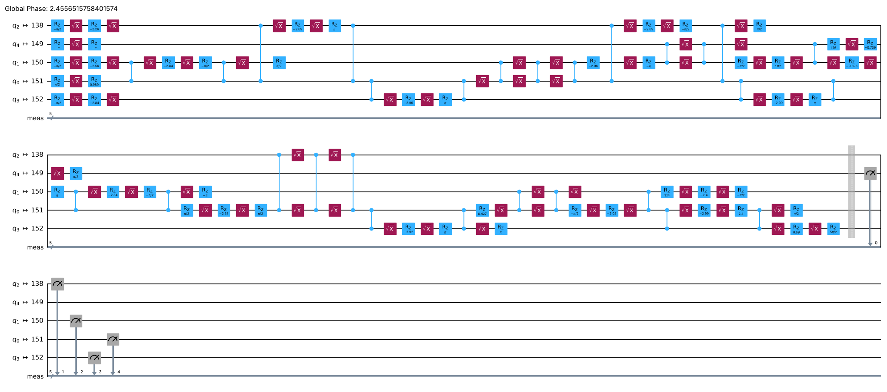

# Relatório técnico — Seleção de controles de cibersegurança sob orçamento com QAOA (ODS 16)

Exercício: *Avaliação Experimental de Problemas de Otimização Alinhados aos Objetivos de Desenvolvimento Sustentável utilizando QAOA* (OQA 2026/2).

Todos os números deste relatório vêm de `exercicio.py` (protocolo completo) e estão em `resultados_exercicio/` (`TABELAS.md`, `execucoes.csv`, `execucoes.json`, `resumo.json`, figuras). As tabelas reproduzidas aqui são cópias de `resultados_exercicio/TABELAS.md`. Os dados são sintéticos e ilustrativos (seção 15).

**Sumário.** 1 Introdução · 2 ODS e justificativa do alinhamento · 3 Descrição do problema · 4 Formulação matemática · 5 Representação binária · 6 Formulação QUBO · 7 Conversão para Ising e Hamiltoniano · 8 Circuito QAOA · 9 Metodologia experimental · 10 Solução clássica de referência · 11 Resultados experimentais · 12 Escalabilidade · 13 Ruído e transpilação · 14 Avaliação no contexto do ODS · 15 Limitações · 16 Conclusão · Apêndice A: respostas Q1–Q22 · Apêndice B: codificação sem folga · Apêndice C: reprodução.

---

## 1. Introdução

Instituições públicas raramente têm orçamento para implantar todos os controles de segurança desejáveis. A decisão de *quais* controles implantar é combinatória: com *k* controles candidatos existem 2^k portfólios, e cada um deve respeitar o orçamento. Este trabalho modela essa decisão como uma mochila 0–1, converte-a em QUBO e em Hamiltoniano de Ising, e executa o QAOA em dois ambientes: simulação ideal (E1) e o *fake backend* FakeKingston, que reproduz topologia, portas nativas e ruído de calibração de um processador IBM Heron r2 de 156 qubits (E2).

A questão central do enunciado é: **até que tamanho de problema o QAOA consegue produzir soluções úteis para uma aplicação associada a um ODS, e quais fatores limitam seu crescimento?** Para respondê-la, o trabalho:

1. define *a priori* um critério de utilidade em dois níveis (seção 9.6), incluindo uma comparação obrigatória com **amostragem uniforme aleatória**, sem a qual não é possível atribuir ao QAOA uma boa solução encontrada entre milhares de medições;
2. executa nove tamanhos de instância (5 a 20 qubits), três sementes por tamanho, p=1,2,3 e dois ambientes;
3. decompõe o efeito do hardware em transpilação, erro de leitura, erro de porta e decoerência;
4. converte o resultado em métricas do domínio (valor de segurança e cobertura de táticas ATT&CK).

Não se pretende demonstrar vantagem quântica, e nenhuma é afirmada.

## 2. Objetivo de Desenvolvimento Sustentável e justificativa do alinhamento

### Justificativa do Alinhamento com os Objetivos de Desenvolvimento Sustentável

#### 2.1 ODS selecionado

- **Número:** ODS 16.
- **Nome:** Paz, Justiça e Instituições Eficazes.
- **Metas relacionadas:** 16.6 (desenvolver instituições eficazes, responsáveis e transparentes em todos os níveis) e 16.10 (assegurar o acesso público à informação e proteger as liberdades fundamentais).
- **Problema tecnológico e institucional associado:** órgãos públicos que oferecem serviços digitais (portal de serviços, base de dados de cidadãos, estações de atendimento) precisam escolher, com orçamento limitado, os controles de segurança que mais reduzem a exposição a ataques. Um incidente compromete a continuidade do serviço público, a confidencialidade dos dados dos cidadãos e a confiança na instituição.

O tema corresponde à linha 13 da Tabela 1 do enunciado (*ODS 16 — Alocação de recursos de cibersegurança: seleção de controles de segurança considerando risco, orçamento e criticidade de serviços*).

> O presente trabalho está alinhado ao ODS 16 – Paz, Justiça e Instituições Eficazes, uma vez que investiga a seleção ótima de controles de cibersegurança para uma instituição pública com orçamento limitado, protegendo serviços digitais e dados de cidadãos que sustentam o funcionamento eficaz e confiável da instituição.

#### 2.2 Problema real associado

- **Recursos alocados:** o orçamento de implantação de controles de segurança (CIS Controls v8), expresso em unidades discretas de custo.
- **Decisões:** implantar ou não cada controle candidato (CIS-1 inventário de hardware, CIS-2 inventário de software, CIS-4 configuração segura, CIS-5 gestão de contas, CIS-7 gestão de vulnerabilidades, CIS-9 proteção de e-mail e navegador, CIS-10 defesa contra malware).
- **Restrições:** a soma dos custos dos controles escolhidos não pode exceder o orçamento *B*. Após a decisão, verifica-se se o portfólio atinge valor mínimo e cobertura mínima de táticas ATT&CK (aceitabilidade organizacional).
- **Resultado a melhorar:** o valor de segurança do portfólio, que combina eficácia ajustada pela adesão humana, cobertura de táticas MITRE ATT&CK, prioridade CIS ponderada pela criticidade e exposição dos ativos, e baixo impacto operacional.

#### 2.3 Indicador otimizado

O indicador otimizado diretamente é o **valor de segurança** V(x) = Σ R_i x_i. Indiretamente, avaliam-se a **cobertura ponderada de táticas ATT&CK** A(x) (fração da relevância das táticas coberta por pelo menos um controle), a **utilização do orçamento** e o **risco residual** representado pelas táticas não cobertas. O valor R_i já incorpora a criticidade e a exposição dos ativos públicos protegidos.

#### 2.4 Relação entre função objetivo e ODS

Maximizar V(x), ou minimizar −V(x), segue a cadeia:

| Decisão matemática | Efeito operacional | Contribuição ao ODS 16 |
|---|---|---|
| x_i = 1 para os controles do portfólio de maior Σ R_i dentro do orçamento | Implantar os controles com maior eficácia efetiva, cobertura de ataques e proteção dos ativos mais críticos e expostos, com menor impacto na operação | Menor probabilidade de interrupção do portal de serviços e de vazamento da base de cidadãos, o que sustenta instituições eficazes (16.6) e protege o acesso à informação e os dados pessoais (16.10) |
| Maximizar o termo de cobertura a_i | Fechar mais táticas ATT&CK (acesso inicial, execução, movimentação lateral, exfiltração) | Redução da superfície de ataque contra serviços públicos |
| Maximizar 1 − f_i | Evitar controles que paralisam o atendimento durante a implantação | Continuidade do serviço público ao cidadão |

#### 2.5 Relação entre restrições e ODS

A restrição Σ c_i x_i ≤ B representa o **limite orçamentário** de uma instituição pública. Ela reflete uma condição real: o orçamento de TI de órgãos públicos é fixado em lei orçamentária e não pode ser excedido; a decisão precisa, portanto, ser a melhor *dentro* do orçamento, e não a mais completa possível. Os limiares pós-decisão V(x) ≥ V_min e A(x) ≥ A_min representam requisitos mínimos de conformidade (por exemplo, uma política interna que exige cobertura mínima de táticas). Eles são avaliados depois da otimização, como no artigo de referência, para não acrescentar variáveis auxiliares.

#### 2.6 Contribuição esperada

Se a solução fosse empregada em um cenário real, a contribuição seria uma **melhor distribuição do orçamento de segurança**: o mesmo orçamento gera mais valor de segurança e mais cobertura de ataques do que uma regra simples, como implantar os controles na ordem numérica do CIS até esgotar o orçamento. A seção 14 quantifica essa diferença. Não é necessário, nem possível com dados sintéticos, demonstrar impacto social real; o que se demonstra é que **a função de otimização representa uma decisão coerente com o ODS 16**.

## 3. Descrição do problema

Uma instituição pública protege três ativos: o portal de serviços públicos, a base de dados de cidadãos e as estações de atendimento. Cada ativo tem impactos de confidencialidade, integridade, disponibilidade, conformidade e reputação, um grau de exposição e dependências com os demais ativos (a base de dados depende do portal, por exemplo). Sete controles CIS são candidatos. Cada um tem custo inteiro (2 a 4 unidades), eficácia técnica, adesão humana, prioridade CIS, impacto operacional, os ativos que protege e as táticas ATT&CK que mitiga. O orçamento de cada instância é ⌊0,45 × custo total dos candidatos⌋. Assim, aproximadamente metade dos controles cabe no orçamento e a escolha não é trivial.

Para estudar o crescimento além dos sete controles reais, a base foi estendida com controles sintéticos S8–S15, aninhados (a instância de 9 controles contém a de 7) e sorteados com semente fixa (2026) **nas mesmas faixas de atributos da base** (custo 2–4, eficácia 0,65–0,90, adesão 0,70–0,90, prioridade 0,80–0,95, impacto 0,15–0,40, 2–3 táticas e 1–3 ativos). A lista completa está em `resultados_exercicio/controles_familia.json`.

## 4. Formulação matemática

**Conjuntos.** C: controles candidatos (|C| = k); A: ativos (3); K: táticas ATT&CK (9).

**Parâmetros.** c_i ∈ ℤ⁺: custo do controle i; B ∈ ℤ⁺: orçamento; e_i: eficácia; ad_i: adesão humana; p_i: prioridade CIS; f_i: impacto operacional; z_ia ∈ {0,1}: o controle i protege o ativo a; m_ik ∈ {0,1}: o controle i mitiga a tática k; q_k: relevância da tática; v_a: criticidade do ativo (impactos ponderados e propagados pelas dependências com η = 0,4); r_a: exposição; λ = 0,5; pesos (α, β, γ, δ) = (0,25; 0,25; 0,25; 0,25).

O valor de cada controle é

R_i = α·(e_i·ad_i) + β·a_i + γ·w_i + δ·(1 − f_i),
a_i = Σ_k q_k m_ik / Σ_k q_k,  w_i = λ·p_i + (1 − λ)·Σ_a z_ia v_a r_a / Σ_a z_ia.

Para a base real: R = (0,6063; 0,5937; 0,5701; 0,5731; 0,6022; 0,5610; 0,6557) e custos c = (2, 2, 3, 3, 4, 2, 3).

**Variáveis.** x_i ∈ {0,1}: implantar o controle i.

**Função objetivo e restrição.**

max V(x) = Σ_{i∈C} R_i x_i, sujeito a g(x) = Σ_{i∈C} c_i x_i − B ≤ 0, x ∈ {0,1}^k,

ou, na forma min f(x) do enunciado, min f(x) = −Σ R_i x_i com g(x) ≤ 0. Não há restrições de igualdade h_j(x) no modelo original; a igualdade surge apenas na codificação com folga (seção 5).

**Pós-avaliação (aceitabilidade).** A(x) = Σ_k q_k min{1, Σ_i m_ik x_i} / Σ_k q_k. Um portfólio é *aceitável* se V(x) ≥ V_min = 1,0 e A(x) ≥ A_min = 0,6.

**Interpretação da solução.** O vetor x* indica quais controles implantar. **Uma solução ótima, no contexto do ODS 16, é o conjunto de controles que entrega o maior valor de segurança possível para os serviços públicos com o orçamento disponível**: nenhum outro conjunto que caiba no orçamento protege melhor, segundo o critério multicritério adotado, os ativos que sustentam o atendimento ao cidadão.

## 5. Representação binária

Cada controle é uma variável de decisão binária:

x_i = 1 se o controle i for implantado; 0 caso contrário.

A desigualdade de orçamento é convertida em igualdade com uma variável de folga inteira s ∈ [0, 2^M − 1], codificada em binário:

Σ_i c_i x_i + s = B,  s = Σ_{m=0}^{M−1} 2^m y_m,  y_m ∈ {0,1},  M = ⌈log₂(B + 1)⌉.

y_m são variáveis auxiliares; não têm significado operacional. O total de variáveis é n = n_decisão + n_auxiliar = k + M:

| Controles k | Orçamento B | M = n_auxiliar | n = qubits |
|---:|---:|---:|---:|
| 3 | 3 | 2 | 5 |
| 4 | 4 | 3 | 7 |
| 5 | 6 | 3 | 8 |
| 6 | 7 | 3 | 9 |
| 7 | 8 | 4 | 11 |
| 9 | 11 | 4 | 13 |
| 11 | 13 | 4 | 15 |
| 13 | 16 | 5 | 18 |
| 15 | 19 | 5 | 20 |

Valores de s > B são representáveis, mas nunca zeram a penalidade (Σ c_i x_i ≥ 0); são estados penalizados, não soluções. Cada portfólio factível tem exatamente uma folga canônica s = B − Σ c_i x_i. Por isso, um mesmo portfólio corresponde a 2^M bitstrings diferentes, e só um deles é o estado de energia correta. Essa distinção entre *decisão* (x) e *codificação completa* (x, y) é central nos resultados.

## 6. Formulação QUBO

Q(x, y) = C(x) + ρ·P(x, y), com

C(x) = −Σ_i R_i x_i (custo original: valor de segurança com sinal trocado),
P(x, y) = (Σ_i c_i x_i + Σ_m 2^m y_m − B)² (violação da igualdade com folga),

o que dá a forma min b^T Q b + ρB², com b = (x, y) ∈ {0,1}^n e Q triangular superior:

Q_ii = ρ(a_i² − 2B a_i) − R_i·[i é controle],  Q_ij = 2ρ a_i a_j (i < j),

em que a = (c_1, …, c_k, 2^0, …, 2^{M−1}). Todos os pares (i, j) têm a_i a_j > 0: o QUBO é **denso** (densidade 1,0, com n(n−1)/2 termos quadráticos). Todo o acoplamento vem da penalidade; a função objetivo original é linear.

**Escolha de λ (ρ).** Usa-se ρ = 1 + Σ_i R_i (5,162 na instância de 7 controles). Justificativa: com custos inteiros, qualquer violação vale pelo menos 1 unidade e é penalizada com pelo menos ρ, que excede o maior ganho possível de valor (Σ R_i). Logo, nenhum estado inviável ou com folga incorreta pode ter energia menor que o melhor estado factível com folga canônica. `ANALISE_MELHORIAS.md` mostra que ρ > max R_i já basta para esta mochila. O valor maior foi mantido para preservar a comparabilidade com o estudo original.

**Verificação experimental de que baixa energia ⇔ solução válida.** Para todas as nove instâncias, a enumeração completa dos 2^n estados confirma que o estado fundamental do QUBO decodifica o ótimo do problema original (`fundamental_e_otimo_original = true` em `resultados_exercicio/modelos/folga_k*/caracteristicas.json`). Os 20 estados de menor energia de cada instância estão em `espectro_20_menores.csv`. Para 7 controles, os onze primeiros:

| Posição | Bitstring (y₃…y₀ x₇…x₁) | Decisão x₁…x₇ | Energia | Factível | Valor | Custo | Cobertura |
|---:|---|---|---:|---|---:|---:|---:|
| 1 | 00011000011 | 1100001 | −1,8557 | sim (ótimo) | 1,8557 | 7 | 66,2% |
| 2 | 00001001001 | 1001001 | −1,8351 | sim | 1,8351 | 8 | 79,4% |
| 3 | 00001000101 | 1010001 | −1,8321 | sim | 1,8321 | 8 | 76,5% |
| 4 | 00011100001 | 1000011 | −1,8230 | sim | 1,8230 | 7 | 55,9% |
| 5 | 00001001010 | 0101001 | −1,8225 | sim | 1,8225 | 8 | 67,6% |
| 6 | 00001000110 | 0110001 | −1,8195 | sim | 1,8195 | 8 | 54,4% |
| 7 | 00011100010 | 0100011 | −1,8104 | sim | 1,8104 | 7 | 58,8% |
| 8 | 00000010011 | 1100100 | −1,8022 | sim | 1,8022 | 8 | 45,6% |
| 9 | 00001101000 | 0001011 | −1,7898 | sim | 1,7898 | 8 | 72,1% |
| 10 | 00001100100 | 0010011 | −1,7868 | sim | 1,7868 | 8 | 69,1% |
| 11 | 00010001011 | 1101000 | −1,7731 | sim | 1,7731 | 7 | 69,1% |

Todos os estados de baixa energia são factíveis e têm a folga canônica. O espectro também mostra uma característica do problema que pesa nos resultados: **os dez portfólios seguintes estão a menos de 4,5% do ótimo**. Os R_i variam pouco (0,56–0,66), porque a média com pesos iguais de quatro critérios normalizados comprime as diferenças. O ótimo é, portanto, pouco destacado.

## 7. Conversão para Ising e construção do Hamiltoniano

Com b_i = (1 − z_i)/2, z_i ∈ {−1, +1}:

H_C = Σ_i h_i Z_i + Σ_{i<j} J_ij Z_i Z_j + C,
J_ij = Q_ij / 4,  h_i = −Q_ii / 2 − Σ_{j≠i} Q_{min(i,j),max(i,j)} / 4,  C = ρB² + Σ_i Q_ii / 2 + Σ_{i<j} Q_ij / 4.

**Coeficientes da instância de 3 controles (5 qubits, B = 3, ρ = 2,770):**

| Qubit | Variável | h_i |
|---:|---|---:|
| 0 | x₁ CIS-1 | −10,7772 |
| 1 | x₂ CIS-2 | −10,7835 |
| 2 | x₃ CIS-4 | −16,3355 |
| 3 | y₀ (2⁰) | −5,5402 |
| 4 | y₁ (2¹) | −11,0803 |

| J_ij | 1 | 2 | 3 | 4 |
|---|---:|---:|---:|---:|
| 0 | 5,5402 | 8,3103 | 2,7701 | 5,5402 |
| 1 | | 8,3103 | 2,7701 | 5,5402 |
| 2 | | | 4,1551 | 8,3103 |
| 3 | | | | 2,7701 |

Termo constante C = 25,4308. A instância de 3 controles tem 5 termos lineares e 10 interações ZZ.

**Instância de 7 controles (11 qubits, B = 8, ρ = 5,162):** h = (−92,61; −92,62; −139,09; −139,09; −185,53; −92,64; −139,05; −46,46; −92,92; −185,84; −371,67), 55 coeficientes J_ij em `resultados_exercicio/modelos/folga_k7/ising_J.csv` e C = 596,72. A instância tem 11 termos lineares e 55 interações ZZ. As contagens de todas as instâncias estão na Tabela 11.1. Em geral, há n termos lineares e n(n−1)/2 interações ZZ.

**Verificação.** Para todos os 2^n estados de todas as instâncias, |E_Ising − E_QUBO| ≤ 10⁻⁸ (campo `erro_max_ising_vs_qubo`). Assim, o estado de menor energia do Hamiltoniano é exatamente a solução ótima do QUBO. O teste `test_folga_qubo_ising_equivalentes` repete essa verificação.

## 8. Construção do circuito QAOA

O estado inicial é |+⟩^{⊗n} (uma porta H por qubit). Para profundidade p,

|γ, β⟩ = Π_{ℓ=1}^{p} e^{−iβ_ℓ H_M} e^{−iγ_ℓ H_C/s} |+⟩^{⊗n},  H_M = Σ_i X_i,

em que s = max_b |E(b)| é uma escala fixa registrada em cada execução (`escala_hamiltoniano`). A escala não altera o estado fundamental; apenas define a unidade de γ. Cada camada é composta por:

- **operador de custo** e^{−iγ H_C/s}: RZ(2γ h_i/s) em cada qubit (termos lineares) e RZZ(2γ J_ij/s) em cada par (interações ZZ). O termo constante C vira fase global;
- **mixer** e^{−iβ H_M}: RX(2β) em cada qubit;
- **medições** na base computacional ao final.

Figura 8.1 — circuito lógico, 3 controles, p = 1 (barreiras rotuladas: estado inicial, U_C(γ₁), U_M(β₁)):

Figura 8.2 — o mesmo circuito transpilado para o FakeKingston (qubits físicos 138, 149–152; portas nativas RZ, √X e CZ):

Os circuitos de 7 controles estão em `resultados_exercicio/circuito_logico_folga_k7.png` e `circuito_transpilado_folga_k7.png`, com versões em texto (`.txt`). Cada execução também guarda o circuito ISA em OpenQASM 3 (`circuito_fake_kingston.qasm`). O teste `test_circuito_didatico_equivale` confirma que a figura com barreiras implementa o mesmo operador do circuito executado, e `test_statevector_equivale_qiskit` confirma que o simulador NumPy usado na otimização coincide com o statevector do Qiskit.

**Relação entre Z_iZ_j e o circuito (Q9).** Cada termo J_ij Z_i Z_j produz exatamente uma porta RZZ(2γJ_ij/s) entre os qubits i e j, porque e^{−iθ Z_i Z_j/2} = RZZ(θ). O número de portas de dois qubits lógicas por camada é, portanto, o número de interações ZZ: 55 para 7 controles. No Heron, a RZZ não é nativa: cada uma vira 2 CZ mais rotações de um qubit. Como o grafo de acoplamento do QUBO é completo e o do hardware é esparso (*heavy-hex*), o roteamento ainda insere SWAPs de 3 CZ cada (seção 13).

## 9. Metodologia experimental

### 9.1 Instâncias

Nove tamanhos: k = 3, 4, 5, 6, 7 (prefixos da base CIS real) e k = 9, 11, 13, 15 (base + controles sintéticos aninhados). O enunciado pede pelo menos cinco tamanhos, e os cinco primeiros cobrem isso com dados da base. A extensão existe para localizar o limite (seção 15). Na codificação com folga, isso dá 5, 7, 8, 9, 11, 13, 15, 18 e 20 qubits. A simulação exaustiva foi limitada a 20 qubits por segurança de memória e tempo.

### 9.2 Ambientes

- **E1 — simulação ideal:** statevector em NumPy, validado contra o `Statevector` do Qiskit. Fornece probabilidades exatas e 2048 shots amostrados dessas probabilidades.
- **E2 — FakeKingston:** `qiskit_ibm_runtime.fake_provider.FakeKingston` (IBM Heron r2, 156 qubits, portas nativas `cz`, `rz`, `sx`, `x`). O circuito lógico com medições é transpilado com `generate_preset_pass_manager(optimization_level=2, backend=FakeKingston)` e executado em `AerSimulator.from_backend(FakeKingston)`, com erros de porta, erros de leitura e relaxação térmica (T1/T2) da calibração do backend, em 2048 shots. E2 foi executado até 17 qubits; acima disso, a simulação ruidosa por trajetórias ficaria inviável (seção 15).
- **E3 — hardware real:** não executado. É opcional no enunciado e exige conta IBM Quantum. O artigo de Santos, Xexéo e Pinto, citado na seção 16, executou uma instância derivada da mesma formulação no `ibm_kingston` real, em outra instância de dados.

Os parâmetros (γ, β) são otimizados apenas em E1 e transferidos sem alteração para E2. Isso isola o efeito do ambiente de execução; não houve reotimização sob ruído.

### 9.3 Otimização dos parâmetros

- Otimizador: COBYLA (SciPy), `rhobeg = 1`, `tol = 1e-5`, até 150·p avaliações por início.
- Função minimizada: E(γ, β) = ⟨γ, β|H_C|γ, β⟩, calculada exatamente pelo statevector e normalizada por s.
- Inícios: dois por execução. Em p = 1, ambos aleatórios (γ ~ U[0, 2π], β ~ U[0, π]). Em p = 2 e 3, um início usa a interpolação INTERP dos parâmetros ótimos de p − 1 (Zhou et al., 2020) e o outro é aleatório. Escolhe-se o de menor energia final.
- Sementes: 42, 43, 44 (otimização, amostragem, transpilação e simulador).
- Registrados por execução: parâmetros iniciais e finais de cada início, avaliações, energia inicial e final, convergência e mensagem do COBYLA, tempo de otimização, curva Energia × Avaliação (`energia_iteracao.png`).

Para o COBYLA, cada iteração corresponde a uma avaliação da função; `optimizer_iterations` registra o total de avaliações de todos os inícios.

### 9.4 Métricas

Para cada execução e ambiente:

- **Popt**: probabilidade de medir o **portfólio ótimo** (qualquer folga). Mede a *fidelidade de decisão*.
- **Pqubo**: probabilidade de medir o **estado fundamental exato do QUBO** (portfólio ótimo e folga canônica). Mede a *fidelidade de codificação*; é a definição de Popt usada no artigo do `ibm_kingston`.
- **Pfeas**: probabilidade de medir um portfólio que respeita o orçamento.
- **P95**: probabilidade de um portfólio factível com V ≥ 0,95·V*.
- **Paceitável**: factível, com V ≥ V_min e A ≥ A_min.
- **E\***: energia ótima (clássica); **E_QAOA**: energia do melhor bitstring amostrado; ⟨H_C⟩: energia esperada.
- **R_app** = V(melhor portfólio factível amostrado) / V\*.
- Melhor bitstring, sua energia, solução decodificada, valor e cobertura; estado mais frequente; indicação se o estado de menor energia foi o mais frequente.
- Recursos: qubits, profundidade, portas totais e de dois qubits do circuito lógico, do circuito na base nativa sem roteamento e do circuito ISA do FakeKingston; número de interações ZZ; shots; tempos de otimização, transpilação e execução.

Em E1, as probabilidades são exatas. Em E2, são frequências de 2048 shots.

### 9.5 Referência de amostragem uniforme

Com 2048 shots e 2^11 = 2048 estados, até um sorteio aleatório observa o ótimo com probabilidade alta. Por isso, cada métrica é comparada com a da **distribuição uniforme sobre os 2^n bitstrings**, que corresponde ao circuito com γ = β = 0 (apenas |+⟩^{⊗n}). O **ganho** é a razão entre a métrica do QAOA e a uniforme (ex.: P95_QAOA / P95_unif).

### 9.6 Critério de utilidade (definido antes da execução)

- **Nível A — decisão útil obtida:** o melhor portfólio factível entre os shots atinge pelo menos 95% do valor ótimo (R_app ≥ 0,95).
- **Nível B — útil e atribuível ao QAOA:** nível A **e** P95 do QAOA maior que P95 da amostragem uniforme. Em E1, usa-se a probabilidade exata. Em E2, usa-se o limite inferior do intervalo de Wilson de 95%, de modo que o ganho não seja atribuído a flutuação de shots.

Uma instância é útil em um nível se a maioria das três sementes satisfaz o critério. A **maior instância útil** é o maior k que satisfaz o critério.

### 9.7 Estudos complementares (7 controles, p = 1, semente 42)

- **Decomposição do ruído:** o mesmo circuito ISA é executado sem ruído, só com erro de leitura, só com decoerência T1/T2, só com erro despolarizante de porta e com o modelo completo.
- **Transpilação:** níveis de otimização 0–3, com e sem roteamento para a topologia física.

### 9.8 Codificação alternativa

Para responder se outra codificação reduz os limites encontrados, a mesma bateria foi executada com **penalização desbalanceada** (Montañez-Barrera et al., 2024), que dispensa a folga: E(x) = −V(x) − λ₁h(x) + λ₂h(x)², com h(x) = B − Σ c_i x_i. Os parâmetros (λ₁, λ₂) foram calibrados **apenas nas instâncias de 3, 4 e 5 controles**: entre os pontos de uma grade cujo estado fundamental é o ótimo nas três, escolheu-se o de maior gap relativo. Depois, ficaram fixos para todas as instâncias. O Apêndice B traz os resultados.

<!-- CONTINUA -->
