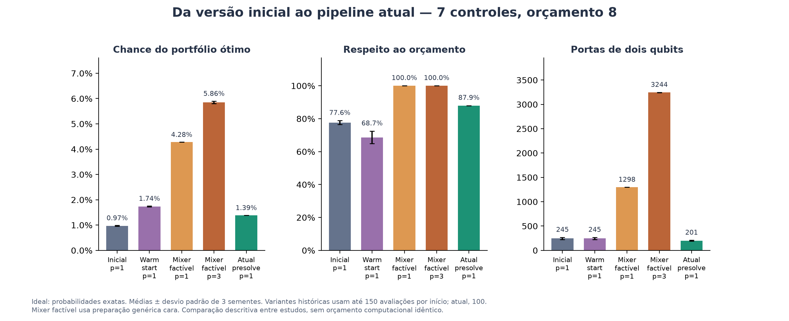
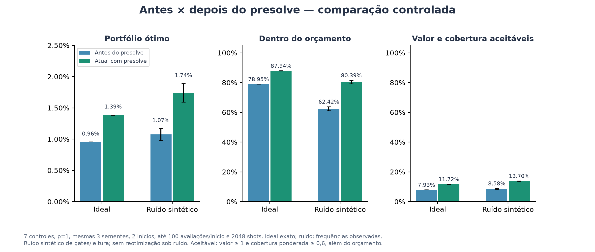
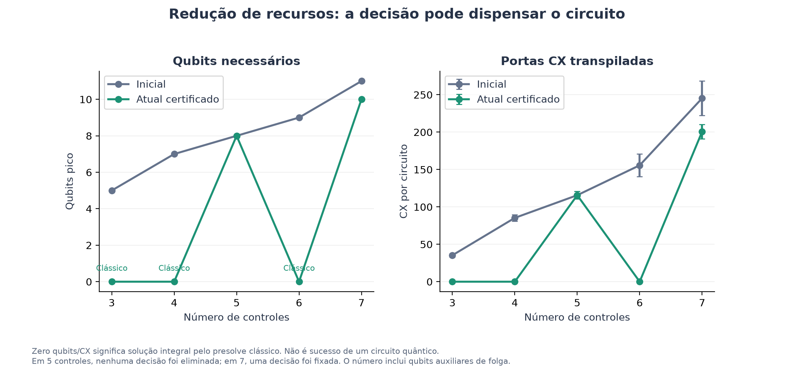
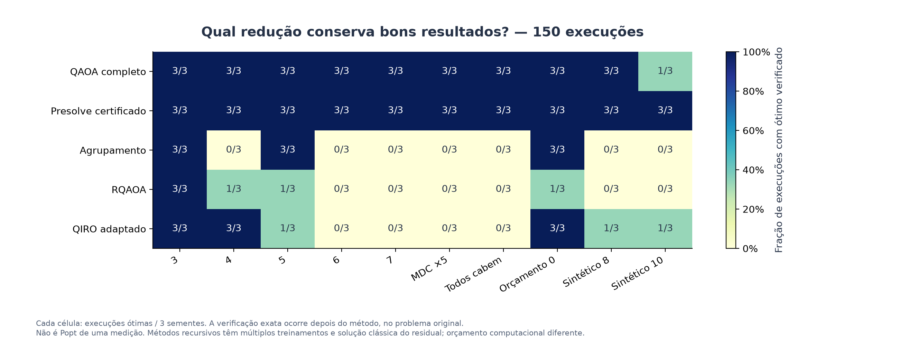
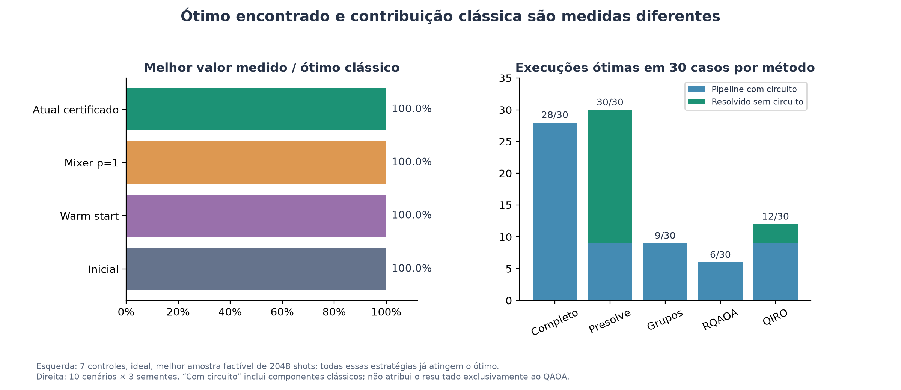

# Gráficos da evolução do projeto

Figuras geradas a partir dos experimentos salvos, sem treinar novamente ou modificar as medições. Há versões PNG em 200 dpi e SVG para ampliação e uso em apresentações. As médias usam três sementes; barras de erro mostram desvio padrão entre sementes, não intervalo de confiança.

## Evolução experimental: sete controles

| Estratégia | Popt ideal | Pfeas ideal | Qubits | CX média |
|---|---:|---:|---:|---:|
| Inicial p=1 | 0.97% | 77.62% | 11 | 245 |
| Warm start p=1 | 1.74% | 68.67% | 11 | 245 |
| Mixer factível p=1 | 4.28% | 100.00% | 7 | 1298 |
| Mixer factível p=3 | 5.86% | 100.00% | 7 | 3244 |
| Atual presolve p=1 | 1.39% | 87.94% | 10 | 201 |



A comparação histórica é descritiva: o estudo inicial e o das melhorias usam até 150 avaliações por início; o atual usa até 100. Penalidades, escalas, ansatz e profundidades também diferem. O mixer factível apresenta o melhor comportamento ideal entre estas variantes, mas exige mais portas; o presolve é o padrão atual por preservar o ótimo na redução e economizar recursos.

## Antes e depois do presolve: comparação controlada



Os dois braços usam a mesma configuração de treino e a mesma instância. Ruído disponível neste estudo para sete controles; a versão inicial histórica só simulou ruído em três controles, por isso não foi inventado um ponto inicial de ruído para sete. As frequências sob ruído não são probabilidades exatas. Aceitabilidade é avaliada no portfólio original.

## Recursos por tamanho



Os zeros nos tamanhos 3, 4 e 6 representam soluções obtidas classicamente pelo presolve. Não são circuitos com zero custo que produziram vantagem quântica.

## Qualidade das reduções



Esta comparação inclui fracassos do agrupamento, RQAOA e QIRO adaptado. Sucesso entre sementes e Popt de uma amostra são grandezas distintas. Os métodos recursivos executam mais treinamentos; a comparação não demonstra superioridade em tempo sob orçamento igual.

## Valor obtido e origem do resultado



A versão inicial já encontrava o melhor portfólio dentro das 2048 medições nas instâncias comparadas. As melhorias alteram a frequência de boas medições e os recursos usados. Entre as 30 execuções do pipeline certificado, 21 dispensaram o circuito e nove usaram QAOA no núcleo.

## Dados e reprodução

- `dados_evolucao.csv`: dados por semente da comparação histórica.
- `dados_antes_depois_ruido.csv`: médias e dispersão da comparação controlada.
- `resumo.json`: valores da tabela principal.
- Fontes: `resultados`, `resultados_melhorias`, `resultados_mixer` e `resultados_reducao`, todos no repositório.

```bash
python graficos_evolucao.py
```

As figuras usam o valor original dos controles e métricas de medição. Energias de QUBOs diferentes não são sobrepostas como se fossem a mesma função objetivo. Os dados são sintéticos e não demonstram vantagem quântica.
